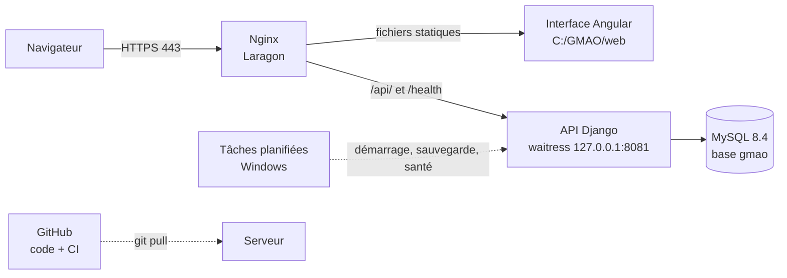
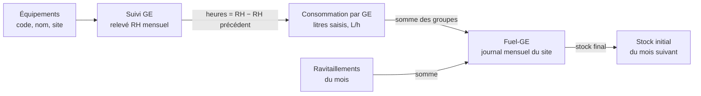
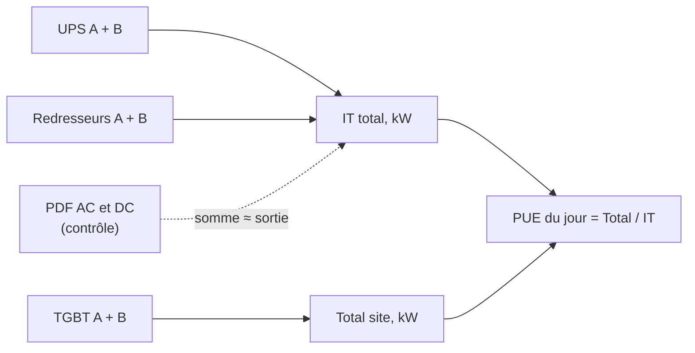

# GMAO

Plateforme web de reporting et de traçabilité des opérations des sites Data Center ORDC : équipements, tickets, groupes électrogènes, carburant, PUE, incidents et pièces de rechange.

| | |
|---|---|
| Application | `https://gmao.test` (nom configurable, voir [Nom d'hôte et certificat](#nom-dhôte-et-certificat)) |
| Santé | `https://gmao.test/health` |
| Code et CI | [GitHub](https://github.com/jeancykabengele-code/GMAO-) |
| Installer le serveur | [docs/installation-serveur.md](docs/installation-serveur.md) |

## Architecture

| Couche | Technologies |
|---|---|
| Interface | Angular 22, TypeScript 6, RxJS, Bootstrap 5, icônes Solaris, export XLSX (write-excel-file) |
| API | Python, Django 6, authentification locale (jetons signés), waitress |
| Données | MySQL 8.4 (SQLite en développement) |
| Exploitation | Laragon (Nginx, MySQL), PowerShell, tâches planifiées Windows |
| Qualité | Vitest, tests Django, Playwright (CSP et bout en bout), GitHub Actions |

**Aucun service en ligne n'est nécessaire au fonctionnement.** GitHub héberge uniquement le code et la CI.

## Modules

| Page | Contenu | Écriture |
|---|---|---|
| Tableau de bord | Indicateurs, filtres site et période | Lecture, rôles globaux |
| Équipements | Registre des actifs, code `EQ-SITE-0001` | Chef de site (son site), rôles globaux |
| Tickets | Demandes et incidents par site | Chef de site, rôles globaux |
| Suivi groupes électrogènes | Relevés RH, heures depuis la dernière PM, état | Chef de site, rôles globaux |
| Interventions réalisées | Journal des interventions | Chef de site, rôles globaux |
| Consommation par GE | Litres par groupe et par mois | Chef de site, rôles globaux |
| Ravitaillement Fuel | Livraisons (1er à 5e du mois) | Chef de site, rôles globaux |
| Fuel-GE | Journal mensuel du site, **calculé** | kWh SNEL et stock initial du premier mois |
| PUE | Relevé journalier de DC Pigeon, en kW | Chef de site de Pigeon |
| Problèmes Data Center | Constats, priorité, échéance, prochaine étape | Chef de site, rôles globaux |
| Pièces de rechange | Mouvements liés à un ticket et un équipement | Chef de site, rôles globaux |
| Documentations | 9 registres complets en XLSX | Lecture, rôles globaux |
| Notifications | Alertes persistantes, rafraîchies toutes les 30 s | Rôles globaux |
| Administration | Sites, utilisateurs, journal d'audit, historique des modifications, sauvegardes | Administrateur |

Chaque feuille de saisie se ferme uniquement après une réponse réussie de l'API ; en cas d'erreur elle reste ouverte avec les valeurs saisies. Un clic sur une notification la marque lue, ouvre la feuille concernée, réinitialise les filtres incompatibles, sélectionne la page et met la ligne en évidence.

## Rôles et permissions

| Action | Administrateur | Manager | Chargé des opérations | Chef de site |
|---|:---:|:---:|:---:|:---:|
| Comptes, sites, journal d'audit, historique, sauvegardes | Oui | Non | Non | Non |
| Voir tous les sites / tableau de bord / Documentations | Non | Oui | Oui | Non |
| Voir son propre site | Non | Oui | Oui | Oui |
| Créer une fiche | Non | Oui | Oui | Son site |
| Modifier une fiche existante | Non | Oui | Oui | Relevés RH, fiches GE et PUE de son site |
| Supprimer une fiche métier | Non | Oui | Oui | Non |
| Exporter en XLSX | Non | Oui | Oui | Non |

Identifiants techniques : `administrator`, `manager`, `charge_operations`, `chef_site`. **Le backend est l'autorité** : masquer un bouton dans Angular ne remplace jamais le contrôle Django. Tant qu'aucun Administrateur actif n'existe, le Manager peut créer le premier compte.

## Règles métier

### Chaîne Fuel et groupes électrogènes

Ordre de saisie conseillé : fiche et relevés RH, ravitaillements, consommation par GE, Fuel-GE. Les feuilles sont reliées par le **site**, le **mois (`AAAA-MM`)** et le **code du groupe**.

| Règle | Formule ou comportement |
|---|---|
| Heures depuis la dernière PM | `RH actuel − RH dernière PM` |
| Prochaine PM | `RH dernière PM + 250` |
| Heures GE du mois (par groupe) | `RH du mois − RH du relevé précédent` |
| Litres par heure | `litres / heures` (si heures > 0) |
| Stock final | `stock initial + ravitaillements − consommation` ; un stock négatif est refusé |
| Stock initial | Stock final du mois précédent ; pour le mois le plus ancien du site, saisi (ou corrigé) par le Chef de site, le Manager ou le Chargé |
| Disponibilité Grid | Calculée à partir des heures du mois et des heures GE ; **0** pour un site hors réseau SNEL |
| Recalcul | Toute création, modification ou suppression d'un relevé RH, d'une consommation ou d'un ravitaillement recalcule le mois et les suivants du site, dans une transaction |
| Champs calculés | Jamais acceptés en saisie manuelle par l'API |
| Compteur RH | Ne peut pas diminuer ; seul le Manager peut approuver une diminution |
| Suppression du dernier relevé RH d'un groupe | Supprime aussi la fiche du groupe |

| État de maintenance | Seuil | Couleur |
|---|---|---|
| Normal | < 175 h | Vert |
| À venir | ≥ 175 h ou retard signalé | Gris |
| Urgente | ≥ 225 h | Jaune |
| Dépassé | ≥ 250 h | Rouge |

La saisie du compteur RH est le **cumul lu sur l'armoire** : si le groupe n'a pas fonctionné, on garde la dernière valeur ; s'il a fonctionné 20 h à 200 h, on saisit 220 h.

### Notifications

| Événement | Niveau | Destinataires |
|---|---|---|
| Fiche créée par un Chef de site | Notification | Manager, Chargé des opérations |
| 150 h depuis la dernière PM (préalerte) | Warning | Manager, Chargé des opérations |
| 175 h, 225 h, 250 h | Warning / critical | Manager, Chargé des opérations |
| Relevé GE non actualisé depuis 7 jours | Warning | Manager, Chargé des opérations |
| Relevé GE non actualisé depuis 14 jours | Critical | Manager, Chargé des opérations |

Une même étape n'est notifiée qu'une fois par groupe, destinataire et cycle de maintenance.

### PUE (DC Pigeon)

| Règle | Détail |
|---|---|
| Périmètre | Site Pigeon uniquement ; 21 équipements du schéma unifilaire, tous obligatoires |
| Relevé | Un par jour, daté par le serveur (heure de Kinshasa), à toute heure |
| Saisie d'une ligne | kW lus, ou ampères et volts ; les kW lus sont prioritaires et l'écart est affiché |
| DC | `kW = V × A / 1000` |
| AC triphasé | `kW = √3 × V × A × cos φ / 1000` (400 V et cos φ = 0,9 par défaut) |
| Contrôles | IT et total strictement positifs ; total ≥ IT |
| PUE de la période | `somme des kW totaux / somme des kW IT` des jours retenus (jamais la moyenne des PUE du jour) |
| Droits | Création : Chef de site de Pigeon ; correction : rôles globaux et Chef de site de Pigeon ; suppression : rôles globaux |

### Sites

Les libellés doivent correspondre exactement à la base (`Mbuji mayi`, `MTC`, `New MTC`) : les filtres utilisent le nom. Le raccordement SNEL est configurable par site (Administration, Gestion des sites) ; Kikwit et Mbandaka sont hors réseau. Renommer un site déplace toutes ses données, notifications et son Chef de site.

## Administration

| Fonction | Règles |
|---|---|
| Sites | Ajout, renommage, code unique, raccordement SNEL, activation. La désactivation ne supprime aucune donnée. |
| Utilisateurs | Création, modification (nom, rôle, site, état), désactivation. Suppression refusée pour son propre compte, un profil affecté à un site, ou un profil ayant créé ou modifié des données métier. |
| Mots de passe | 14 caractères minimum ; valeurs courantes, numériques ou compromises refusées ; 5 anciens hachages conservés ; changement forcé après création ou réinitialisation ; la réinitialisation exige le mot de passe de l'Administrateur. |
| Journal d'audit | Connexions, échecs, mots de passe, comptes, suppressions sensibles ; sans mot de passe ni jeton ; **append-only**. |
| Historique des modifications | Création, modification et suppression de chaque fiche, avec ancienne et nouvelle valeur. |
| Sauvegardes | Archive ZIP à la demande (données métier, sites, comptes hors mots de passe, journal d'audit). |

Les adresses e-mail servent d'identifiants : aucune boîte n'est requise.

## Développement local

| Étape | Commande |
|---|---|
| Frontend (http://localhost:4200) | `cd gmao-frontend` puis `npm install` puis `npm start` |
| Backend (http://localhost:8080) | `cd gmao` puis `python -m venv .venv` puis `.\.venv\Scripts\python.exe -m pip install -r requirements.txt` puis `.\start-django.ps1` |
| Santé | `Invoke-WebRequest http://localhost:8080/health` |
| Tests frontend | `npm run test:ci` (couverture : `npm run test:coverage`) |
| Tests backend | `$env:DJANGO_DEBUG='true'; python manage.py test` (couverture : `python -m coverage run manage.py test`) |
| CSP dans Chromium | `npm run build:production` puis `npm run test:csp` |
| Bout en bout | `npm run test:e2e` (vrai Django sur SQLite jetable et vrai Chromium) |

| Contrôle | Seuil |
|---|---|
| Couverture backend | 80 % (`gmao/.coveragerc`) |
| Couverture frontend | seuils de non-régression dans `angular.json` |
| Budget Angular | 1,2 Mo pour le bundle initial, 10 Ko par feuille de style |

Sans `GMAO_DATABASE_ENGINE=mysql`, Django utilise SQLite. Le chemin `gmao/profiles/records/` contient l'API des fiches (`constants`, `serialization`, `equipment`, `generators`, `fuel`, `deliveries`, `pue`, `endpoints`) ; les tests sont répartis par domaine dans `gmao/profiles/test_*.py`.

## Configuration

Fichier `gmao\.env.laragon` (ignoré par git, modèle : `ops/laragon/gmao.env.example`).

| Variable | Rôle | Défaut |
|---|---|---|
| `DJANGO_SECRET_KEY` | Clé cryptographique | Obligatoire hors debug |
| `DJANGO_DEBUG` | Mode debug | `false` |
| `DJANGO_ALLOWED_HOSTS` | Hôtes autorisés | `localhost,127.0.0.1` |
| `FRONTEND_ORIGINS` | Origines CORS | Ports Angular locaux |
| `GMAO_DATABASE_ENGINE` | `mysql` en exploitation | SQLite |
| `GMAO_DB_HOST` / `PORT` / `NAME` / `USER` / `PASSWORD` | Connexion MySQL | `-` / `3306` / `gmao` / `gmao_app` / `-` |
| `GMAO_DB_CA_PATH` / `GMAO_DB_CA_PEM` | Certificat CA (TLS) | Aucun |
| `GMAO_MYSQL_SSL` | `false` seulement pour un MySQL sur la même machine | `true` |
| `GMAO_TRUSTED_PROXIES` | Proxys autorisés à fournir `X-Real-IP` | `127.0.0.1,::1` |
| `GMAO_HEALTH_TOKEN` | Secret de `/health/database` (vide = sonde désactivée) | Vide |
| `GMAO_BACKUP_TOKEN` | Secret de l'export planifié (vide = désactivé) | Vide |
| `GMAO_LOCAL_TOKEN_MAX_AGE` | Durée de session (s) | `43200` |
| `GMAO_PWNED_PASSWORD_CHECK` | Contrôle des mots de passe compromis (service en ligne) | `true` hors debug |
| `DJANGO_SECURE_SSL_REDIRECT` / `DJANGO_SECURE_HSTS_SECONDS` | Redirection HTTPS et HSTS | `false` / `0` |

Frontend : `src/environments/environment.ts` (`apiUrl`), généré en production par `GMAO_API_URL`. Le navigateur ne reçoit aucune clé de base de données.

## Base de données

Les 16 tables métier sont gérées par des **migrations Django versionnées** (`profiles`) ; les tables techniques par `login_guard`. Le démarrage de l'API applique les migrations puis `verify_business_schema`. Voir [docs/migrations-metier.md](docs/migrations-metier.md).

| Groupe | Tables |
|---|---|
| Comptes | `user_profiles`, `sites`, `gmao_local_credentials`, `gmao_password_history` |
| Métier | `gmao_equipements`, `gmao_tickets`, `gmao_groupes_electrogenes`, `gmao_releves_rh_ge`, `gmao_fuel_ge`, `gmao_fuel_ravitaillements`, `gmao_consommations_groupes_ge`, `gmao_fuel_monthly_summary`, `gmao_pue`, `gmao_problemes_datacenter`, `gmao_interventions`, `gmao_pieces_rechange` |
| Technique | `gmao_notifications`, `gmao_login_buckets`, `audit_log` (append-only, déclencheurs d'immutabilité) |

## API

Toutes les routes, hors santé, exigent `Authorization: Bearer <jeton de session>`.

| Méthode | Route | Rôle |
|---|---|---|
| `GET` | `/health` | Santé du serveur (public) |
| `GET` | `/health/database` | Connexion MySQL ; `GMAO_HEALTH_TOKEN` en Bearer |
| `POST` | `/api/auth/local/login` · `logout` · `change-password` | Session |
| `GET` | `/api/me` | Profil et permissions calculées |
| `GET` `POST` | `/api/records/<ressource>` | Liste, création |
| `PUT` `PATCH` `DELETE` | `/api/records/<ressource>/<uuid>` | Modification, suppression |
| `GET` `PATCH` | `/api/notifications`, `/<uuid>/read`, `/read-all` | Notifications |
| `GET` `POST` `PATCH` `DELETE` | `/api/sites`, `/api/sites/<nom>` | Sites (écriture : Administrateur) |
| `GET` `POST` `PATCH` | `/api/profiles`, `/<uuid>`, `/<uuid>/password`, `/<uuid>/delete` | Utilisateurs (Administrateur) |
| `GET` | `/api/audit-logs`, `/api/change-history` | Journal d'audit, historique (Administrateur) |
| `POST` | `/api/backups/export` | Archive ZIP (Administrateur) |
| `POST` | `/api/backups/scheduled-export` | Même archive, `GMAO_BACKUP_TOKEN` en Bearer |

Ressources : `equipements`, `tickets`, `groupes-electrogenes`, `releves-rh-ge`, `fuel-ge`, `consommations-groupes-ge`, `fuel-ravitaillements`, `fuel-summary`, `pue`, `problemes-datacenter`, `interventions`, `pieces-rechange`. Un Chef de site ne reçoit que les données de son site.

## Exploitation

### Composants installés

| Composant | Détail |
|---|---|
| Interface | `C:\GMAO\web`, servie par Nginx (`ops\laragon\gmao.test.conf`) |
| API | `gmao\.venv-laragon`, tâche `GMAO API` (`ops\laragon\start-api.ps1`) |
| Base | MySQL 8.4 de Laragon, `127.0.0.1`, base `gmao` |
| Secrets, certificat, sauvegardes | `C:\GMAO\.secrets`, `C:\GMAO\ssl`, `C:\GMAO\backups` |

### Mettre à jour le serveur

| Étape | Commande |
|---|---|
| 1. Sauvegarder | `.\ops\laragon\backup-mysql.ps1` |
| 2. Récupérer le code (CI verte) | `git pull origin main` |
| 3. Publier l'interface | `.\ops\laragon\build-frontend.ps1` (tests, build, copie vers `C:\GMAO\web`) |
| 4. Redémarrer l'API | `Stop-ScheduledTask 'GMAO API'; Start-ScheduledTask 'GMAO API'` |

Le démarrage de l'API attend MySQL (jusqu'à 15 minutes), applique les migrations, contrôle le schéma et purge les compteurs de connexion ; il échoue si une étape échoue.

### Tâches planifiées

| Tâche | Déclencheur | Script |
|---|---|---|
| `GMAO API` | Démarrage de Windows | `ops\laragon\start-api.ps1` |
| `GMAO sauvegarde` | Chaque jour à 02:00 | `ops\laragon\backup-mysql.ps1` (option `-CopyTo` pour une copie hors disque) |
| `GMAO santé` | Toutes les 10 minutes | `ops\laragon\check-health.ps1` (journal `C:\GMAO\health.log`) |

Laragon démarre MySQL et Nginx à l'ouverture de session (réglages : démarrer avec Windows, tout démarrer automatiquement, minimisé, mise à jour automatique désactivée). Procédure d'incident : [docs/incident-disponibilite.md](docs/incident-disponibilite.md).

### API Django

- `/health` est public et indépendant de MySQL. `/health/database` répond 401 sans jeton valide, 200 (`status=UP`, `database=UP`, `responseTimeMs`) si la connexion fonctionne, 503 sinon. La sonde exécute `SELECT 1` : elle ne vérifie pas le schéma.
- `GMAO_HEALTH_TOKEN` : 32 octets aléatoires au moins, distinct de `DJANGO_SECRET_KEY`, jamais placé dans Angular ni dans une URL.
- Sans `DJANGO_SECRET_KEY`, le démarrage est refusé hors debug.

### Protection des connexions

| Limite | Valeur |
|---|---|
| Échecs par couple IP et e-mail | 5 sur 15 minutes, attente de 1, 2, 4 puis 8 secondes entre les essais |
| Échecs par IP, tous e-mails confondus | 50 sur 15 minutes |
| Refus | HTTP 429 avec `Retry-After` ; HTTP 503 si le stockage des compteurs est indisponible (jamais de contournement) |
| Adresse du client | `X-Real-IP`, écrasé par Nginx, seulement si la connexion TCP vient d'un proxy de confiance (`GMAO_TRUSTED_PROXIES`) ; `X-Forwarded-For` toujours ignoré |
| Journalisation | Identifiants HMAC, sans mot de passe, jeton, IP brute ni e-mail brut |

`purge_login_buckets` supprime les fenêtres de plus de 24 heures. Changer `DJANGO_SECRET_KEY` change les clés HMAC et redémarre les quotas. Vérification : un identifiant inexistant, cinq essais, puis HTTP 429 au sixième.

### Sauvegardes

| Mode | Contenu | Où |
|---|---|---|
| Quotidienne | `mysqldump` complet compressé, rotation de 30 jours | `C:\GMAO\backups` (+ `-CopyTo`) |
| À la demande | ZIP applicatif lisible, JSON par table, comptes sans mots de passe | Téléchargement (Administration, Sauvegardes) |

Restaurer : importer le `.sql` d'une archive dans une base vide, démarrer l'API. Tester la restauration au moins une fois par trimestre.

### Nom d'hôte et certificat

Le nom (`gmao.test` par défaut) n'est écrit dans aucun fichier de code.

| Où | Quoi | Ensuite |
|---|---|---|
| `hosts` ou DNS interne | Le nom pointe vers le serveur | Rien |
| `gmao.test.conf` (Nginx) | `server_name` | Recharger Nginx |
| `gmao\.env.laragon` | `DJANGO_ALLOWED_HOSTS`, `FRONTEND_ORIGINS` | Redémarrer l'API |
| Build | `build-frontend.ps1 -ApiUrl https://<nom>` | Nouveau build |
| Certificat | `new-certificate.ps1 -HostName <nom>` puis import sur chaque poste | Recharger Nginx |

Le joker `*.test` de Laragon est refusé par Windows : le nom doit figurer tel quel dans le certificat. Les utilisateurs se reconnectent une fois sur la nouvelle adresse.

### Détection d'une nouvelle version

Chaque build produit `public/version.json`. L'interface le relit toutes les 5 minutes et à chaque retour sur l'onglet, et propose un rafraîchissement sans jamais recharger toute seule.

## Sécurité

| Mesure | Détail |
|---|---|
| Secrets | Jamais versionnés (`.env*`, mots de passe, jetons) ; dossier `C:\GMAO\.secrets` restreint |
| Transport | HTTPS, HSTS, TLS 1.2+ ; API joignable uniquement par Nginx (`127.0.0.1`) |
| CSP | Politique unique dans `ops/laragon/gmao.test.conf`, vérifiée dans Chromium par la CI |
| Sessions | Stockage de l'onglet ; cookie `HttpOnly` non encore réalisé ([docs](gmao-frontend/docs/security-browser.md)) |
| Autorisations | Contrôlées côté Django, quelle que soit l'interface |
| Base | MySQL sur la machine, compte applicatif limité à la base `gmao`, compte de sauvegarde en lecture seule |

## Dépannage

| Symptôme | Cause probable | Action |
|---|---|---|
| Enregistrement réussi mais feuille visible | Réponse en erreur | Console du navigateur et réponse de la requête ; la feuille ne se ferme qu'après succès |
| Lenteur, erreur 502 | API arrêtée ou MySQL indisponible | `/health`, tâche `GMAO API`, MySQL dans Laragon |
| Aucune donnée | API injoignable, `apiUrl` faux, profil inactif | `/health`, `environment.apiUrl`, `user_profiles.active` |
| Un site sans données | Libellé ou casse différents, site inactif | Comparer avec la colonne `site` et la table `sites` |
| Erreur CORS | Origine absente de `FRONTEND_ORIGINS` | Ajouter l'origine exacte, sans barre finale |
| Profil refusé | UUID différent, `active = false`, rôle inconnu, `chef_site` sans site | Corriger le profil |
| Base injoignable | MySQL arrêté ou identifiants faux | Port 3306 dans Laragon, `GMAO_DB_*` |
| HTTP 429 à la connexion | 5 échecs en 15 minutes | Attendre le délai de `Retry-After` |
| Avertissement du navigateur | Certificat non importé | `Import-Certificate` du `.crt` de `C:\GMAO\ssl` |

## Charte visuelle Orange

| Élément | Règle |
|---|---|
| Typographie | Helvetica Neue 55, 65, 75 |
| Couleurs | Noir, blanc, Orange `#FF7900`, gris ; vert = validation, Orange = attention, rouge = erreur |
| Icônes | Pack Solaris local (`gmao-frontend/public/assets/orange/icons`) |
| Logo | Master Logo Orange officiel (`.../logo/orange-master-logo.png`) |

## Documentation détaillée

| Document | Sujet |
|---|---|
| [docs/installation-serveur.md](docs/installation-serveur.md) | Installation pas à pas sur Laragon |
| [docs/incident-disponibilite.md](docs/incident-disponibilite.md) | Supervision et procédure d'incident |
| [docs/migrations-metier.md](docs/migrations-metier.md) | Migrations, adoption du schéma, retour arrière |
| [docs/politique-mots-de-passe.md](docs/politique-mots-de-passe.md) | Règles de mot de passe |
| [docs/gestion-utilisateurs.md](docs/gestion-utilisateurs.md) | Administration des comptes |
| [docs/journal-audit.md](docs/journal-audit.md) | Journal d'audit |
| [gmao-frontend/docs/security-browser.md](gmao-frontend/docs/security-browser.md) | CSP et sessions navigateur |

## Évolutions prévues

- Envoi d'e-mails pour les alertes warning et critical.
- Import massif XLSX avec validation et rapport d'erreurs (aujourd'hui : exports seulement).
- Réduction des bundles Angular et des styles partagés.
- Copie automatique des sauvegardes hors du serveur.

Tenir ce fichier à jour lors de l'ajout d'un module, d'un rôle, d'une table, d'une route, d'une variable ou d'une règle métier.
