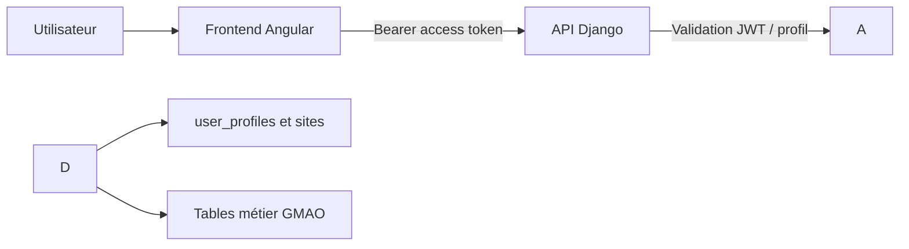

# GMAO

Plateforme web de reporting et de traçabilité des opérations sur les sites Data Center ORDC. Elle centralise les équipements, interventions, tickets, groupes électrogènes, carburant, PUE, problèmes Data Center, pièces de rechange et ravitaillements Fuel.

> Guide pratique : [déploiement GitHub, Vercel et Render](DEPLOIEMENT.md).

## Accès au projet

| Environnement | Adresse |
|---|---|
| Application de production | [https://gmao-ordc.vercel.app](https://gmao-ordc.vercel.app) |
| API de production | [https://gmao-ordc-api.onrender.com](https://gmao-ordc-api.onrender.com) |
| Santé de l’API | [https://gmao-ordc-api.onrender.com/health](https://gmao-ordc-api.onrender.com/health) |
| Dépôt GitHub | [Projet_Reporting_DC](https://github.com/jeancykabengele-code/Projet_Reporting_DC) |

> Le backend utilise actuellement une instance Render gratuite. Après une période d’inactivité, la première requête peut prendre environ 50 secondes ou davantage pendant le redémarrage du service.

## Sommaire

- [Accès au projet](#accès-au-projet)
- [Fonctionnalités](#fonctionnalités)
- [Architecture](#architecture)
- [Technologies](#technologies)
- [Charte visuelle Orange](#charte-visuelle-orange)
- [Rôles et permissions](#rôles-et-permissions)
- [Structure du dépôt](#structure-du-dépôt)
- [Installation locale](#installation-locale)
- [Configuration](#configuration)
- [Base de données](#base-de-données)
- [API](#api)
- [Règles métier](#règles-métier)
- [Tests et compilation](#tests-et-compilation)
- [Déploiement](#déploiement)
- [Dépannage](#dépannage)
- [Évolutions prévues](#évolutions-prévues)
- [Sécurité](#sécurité)
- [Administration](#administration)

## Fonctionnalités

### Tableau de bord

- Vue consolidée des indicateurs opérationnels.
- Filtrage global par site et par période.
- Synthèse des équipements, tickets, interventions, groupes électrogènes, Fuel-GE et PUE.
- Accès réservé au Manager GMAO et au Chargé des opérations.

### Équipements

- Registre des actifs techniques par site.
- Gestion du nom, de la famille, de la localisation, du modèle, de l’état et de la criticité.
- Génération automatique d’un code de type `EQ-SITE-0001`.
- Suppression possible uniquement pour les rôles globaux.

### Gestion des tickets

- Enregistrement et suivi des demandes ou incidents.
- Association à un site, un équipement, un porteur, une entreprise et un motif.
- Recherche, filtres et pagination.

### Maintenance

- Journal des interventions réalisées.
- Suivi des groupes électrogènes et de leurs compteurs horaires.
- Calcul automatique du nombre d’heures depuis la dernière maintenance préventive.
- Détermination automatique de l’état de maintenance du groupe.

### Fuel-GE

- Le chef de site renseigne le site, le mois et le kWh SNEL lorsque le site est raccordé ; la consommation Fuel est calculée, elle n’est jamais saisie dans cette feuille.
- Fuel-GE additionne automatiquement les consommations par groupe GE du site pour le mois sélectionné.
- Le stock initial, les ravitaillements du mois, les heures GE, le stock final, les litres par heure et la disponibilité Grid sont calculés par Django.
- Le stock de départ est le stock initial du **mois le plus ancien** du site ; il est saisi par le Chef de site, le Manager ou le Chargé des opérations. Ajouter un mois plus ancien que les journaux existants (2025, 2024…) en fait le nouveau mois de départ : les mois suivants reprennent alors son stock final. Le formulaire prévient quel mois sera remplacé.
- Le stock initial du mois le plus ancien peut être corrigé (Manager ou Chargé des opérations) ; celui des autres mois reste calculé et en lecture seule.
- Avant d’enregistrer, le formulaire liste par groupe les relevés RH présents ou manquants (✅ / ❌), signale les groupes sans consommation (sortie comptée à 0 L) et grise **Enregistrer** tant qu’un prérequis bloquant manque.
- Toute modification d’un ravitaillement, d’un relevé RH GE ou d’un ancien journal recalcule les journaux Fuel-GE dépendants du même site.
- Les champs calculés sont protégés : l’API refuse toute modification manuelle de ces valeurs.
- Le Manager et le Chargé des opérations peuvent supprimer une ligne Fuel-GE depuis le formulaire de modification. Les mois suivants sont recalculés ; la suppression est refusée si elle rend un stock de départ incohérent.

### Liaisons entre les feuilles Fuel et GE

Les données sont reliées par le **site**, le **mois (`AAAA-MM`)** et, pour les relevés/consommations, le **code du groupe**. L’équipement enregistré dans **Équipements** est la source du code, du nom et du site des groupes électrogènes proposés dans **Suivi groupes électrogènes**.

**Ordre de saisie conseillé pour un site :** fiche du groupe et relevés RH → ravitaillements → consommation par GE → Fuel-GE. Chaque feuille affiche une courte note de rappel et, quand un relevé RH manque, le formulaire indique lequel (groupe et mois) et bloque l’enregistrement au lieu de renvoyer une erreur.

1. **Suivi groupes électrogènes** enregistre un relevé RH par groupe et par mois. Les heures d’un groupe sont calculées par `RH du mois − RH du relevé précédent`. Une référence de décembre permet donc de calculer les heures de janvier.
2. **Consommation par groupe GE** reçoit les litres saisis pour le même groupe et le même mois. Elle reprend les heures calculées au point 1 et calcule `L/h = litres / heures`.
3. **Ravitaillement Fuel** enregistre chaque livraison par **mois** et **numéro dans le mois** (1er à 5e ravitaillement), comme dans les rapports de terrain : aucune date n’est demandée. Sa quantité est additionnée automatiquement dans le mois concerné (un numéro non saisi compte pour 0) ; les stocks avant/après servent de contrôle physique de la livraison et ne remplacent pas les calculs Fuel-GE.
4. **Fuel-GE** est la synthèse mensuelle du site : `stock final = stock initial + somme des ravitaillements − somme des consommations`. Il additionne également les heures de tous les groupes et calcule la moyenne `L/h`. Dès le deuxième mois, le stock initial reprend le stock final du mois précédent. Le premier mois d’un site sans aucune consommation n’exige pas de relevés RH ; dès qu’un mois plus ancien est ajouté, les mois suivants ont besoin d’un relevé antérieur pour leurs heures GE.

Une création, une modification ou une suppression de relevé RH, consommation ou ravitaillement recalcule Fuel-GE du mois concerné et les mois suivants du site. Les modifications et suppressions effectuées par le Manager ou le Chargé des opérations passent par l’API Django : l’enregistrement est d’abord mis à jour ou supprimé dans Aiven MySQL, puis l’interface est rafraîchie (journal Fuel-GE compris, car le serveur le recalcule).

**Suppression d’un relevé RH :** supprimer le dernier relevé d’un groupe supprime aussi sa fiche (dont le RH de la dernière PM), car la ligne de suivi n’existe plus. Supprimer un seul relevé parmi plusieurs resynchronise la fiche sur le dernier relevé restant. Une fiche sans aucun relevé (reliquat) n’est pas comptée au tableau de bord et est remplacée quand le groupe est recréé ; le formulaire « Renseigner un compteur » repart alors de zéro. **Mettre à jour** sur la ligne d’un mois corrige ce relevé : le Manager et le Chargé des opérations le font sur tous les sites, le Chef de site sur les relevés de son propre site ; choisir un autre mois crée un nouveau relevé. La suppression d’un relevé reste réservée au Manager et au Chargé des opérations.

### Consommation par groupe GE

- Suivi mensuel de la consommation Fuel de chaque groupe électrogène.
- Une seule ligne est autorisée par combinaison **site + mois + groupe**.
- Le chef de site saisit les litres consommés et un commentaire facultatif.
- Les heures GE sont calculées depuis les deux derniers relevés RH du groupe : `RH du mois − RH précédent`.
- Une saisie est refusée si un relevé RH manque, si le compteur diminue, ou si les litres sont négatifs ; le formulaire indique le relevé manquant et grise **Enregistrer** tant qu’il n’est pas saisi.
- Les L/h sont calculés automatiquement. La somme des groupes alimente Fuel-GE ; toute création, correction ou suppression recalcule le mois concerné et les mois suivants.
- La table correspondante a été migrée vers Aiven MySQL.
### Ravitaillement Fuel

- Enregistrement des livraisons entrantes de carburant par site, par mois et par numéro de ravitaillement (1 à 5 par site et par mois, sans doublon). Les anciennes dates sont conservées en base mais ne sont plus affichées ni demandées ; l’API accepte encore une date pour en déduire le mois.
- Les imports historiques peuvent conserver les stocks avant/après à « Non renseigné » lorsqu’ils ne sont pas disponibles.
- Calcul automatique du stock après livraison et signalement des écarts.
- Le chef de site ajoute les ravitaillements de son site ; les rôles globaux consultent les données de tous les sites.
- Chaque nouvel enregistrement notifie le Manager GMAO et le Chargé des opérations.
- Le schéma et les données sont gérés dans Aiven MySQL par Django.

### PUE

- Saisie de l’énergie IT et de l’énergie totale.
- Calcul automatique du PUE : `énergie totale / énergie IT`.
- Suivi par site et par mois.

### Problèmes Data Center

- Journal des constats techniques.
- Suivi du statut, de la priorité, du responsable, de l’échéance, du besoin en pièces et de la prochaine étape.

### Pièces de rechange

- Journal des mouvements de pièces.
- Liaison avec le ticket, l’équipement, l’agent et le statut de l’opération.


### Gestion des utilisateurs depuis le back office

- Seul l'Administrateur peut ouvrir **Administration → Gestion des utilisateurs** après l'amorçage du premier compte.
- Le formulaire permet de saisir le nom complet, l’adresse e-mail, le rôle et le site du chef de site.

- La désactivation conserve le compte et son historique ; elle est recommandée dès qu’un profil possède des données métier.

### Modification des profils

- Seul l'Administrateur peut modifier le nom complet, le rôle, le site associé et le statut actif/inactif des comptes.

- Un chef de site doit toujours être associé à un site actif.
- Un administrateur ne peut pas désactiver son propre compte depuis cette interface.
- La désactivation conserve le profil, les fiches métier et l historique ; le backend refuse ensuite le chargement du profil à la connexion.

### Suppression sécurisée des profils

- Le bouton **Supprimer définitivement** ouvre une confirmation intégrée à l’application, sans boîte de dialogue du navigateur.
- La suppression est refusée pour son propre compte, pour un profil encore affecté à un site, ou dès qu’une donnée métier a été créée ou modifiée par ce profil.
- Dans ces cas, il faut désactiver le compte afin de conserver l’historique et empêcher toute nouvelle connexion.

### Journal d’audit

- Seul l'Administrateur peut ouvrir **Administration → Journal d’audit**.
- Les connexions, échecs, changements et réinitialisations de mot de passe, opérations sur les comptes et suppressions sensibles y sont historisés.
- Le journal affiche l’acteur, la date, l’adresse IP, la cible, le résultat et les changements utiles, sans mot de passe ni jeton.
- La table et l’API sont append-only : aucune modification ou suppression d’un événement n’est exposée.


### Documentation et exports Excel XLSX

- Téléchargement de neuf registres complets au format Excel XLSX depuis la page **Documentations**.
- Export des données filtrées depuis chaque feuille métier.
- Classeur XLSX structuré avec une feuille nommée, des cellules typées et des colonnes ajustées.
- Ajout du titre, de la date d’export, d’un en-tête figé et d’une mise en forme lisible.
- Fonction réservée au Manager GMAO et au Chargé des opérations.

### Formulaires de renseignement

- L’enregistrement est transmis à l’API Django.
- Après une réponse réussie, la feuille de saisie se ferme automatiquement et la liste locale est actualisée.
- Si l’enregistrement échoue, la feuille reste ouverte afin de préserver les informations saisies.
- Cette fermeture fiable est appliquée aux équipements, tickets, groupes électrogènes, Fuel-GE, PUE, problèmes Data Center, interventions et pièces de rechange.

### Navigation depuis une notification

- Un clic marque immédiatement la notification comme lue et la retire de la barre latérale.
- La feuille métier concernée est ouverte avec l’identifiant de la fiche.
- Les filtres incompatibles sont réinitialisés.
- La pagination sélectionne automatiquement la page contenant l’enregistrement.
- Le tableau défile jusqu’à la ligne concernée et la met temporairement en évidence.

### Limite actuelle des imports

La fonctionnalité utilisateur actuelle couvre les exports Excel XLSX. Aucun import massif PDF ou CSV n’est exposé dans l’interface. L’import massif XLSX avec validation reste une évolution prévue.

## Architecture




## Technologies

| Couche | Technologies |
|---|---|
| Frontend | Angular 22, TypeScript 6, RxJS, Bootstrap 5, icônes Solaris |
| Authentification | Django locale, jetons signés |
| Backend | Python 3.14, Django 6 |
| Base de données | Aiven MySQL, SQLite pour le développement local |
| Excel XLSX | write-excel-file |
| Tests frontend | Vitest |
| Serveur de production | Gunicorn |
| Conteneur et hébergement | Docker, Render |

## Charte visuelle Orange

L’interface applique la charte Orange sur l’ensemble des écrans.

- **Typographie** : Helvetica Neue 55 (texte courant), 65 (intermédiaire) et 75 (titres et éléments forts).
- **Logo** : Master Logo Orange officiel, conservé dans son format carré avec une zone de sécurité et un affichage responsive desktop/mobile.
- **Couleurs principales** : noir, blanc, Orange `#FF7900` et gris numérique.
- **Icônes** : pack Solaris local. `bootstrap-icons` n’est plus chargé ni déclaré comme dépendance.
- **Composants** : menu, boutons, tableaux, formulaires, alertes, fenêtres et focus utilisent le système de couleurs Orange.
- **États métier** : vert réservé à la validation, Orange à l’attention ou au suivi, rouge aux erreurs et situations critiques ; gris pour les informations neutres.
- **Graphiques** : Orange est la série principale ; les gris servent aux comparaisons et les couleurs d’état uniquement aux données métier concernées.

Les ressources de la charte se trouvent dans `gmao-frontend/public/assets/orange/` :

```text
gmao-frontend/public/assets/orange/
├── fonts/                         # Helvetica Neue 55, 65 et 75
├── icons/                         # Icônes Solaris officielles
│   └── manifest.json              # Correspondance historique Bootstrap → Solaris
└── logo/orange-master-logo.png    # Master Logo officiel
```
## Rôles et permissions

Les rôles reconnus sont `administrator`, `manager`, `charge_operations` et `chef_site`.

| Action | Administrateur | Manager GMAO | Chargé des opérations | Chef de site |
|---|:---:|:---:|:---:|:---:|
| Administrer les comptes et les sites | Oui | Non | Non | Non |
| Consulter le journal d'audit | Oui | Non | Non | Non |
| Générer une sauvegarde de la base | Oui | Non | Non | Non |
| Voir tous les sites métier | Non | Oui | Oui | Non |
| Voir son propre site | Non | Oui | Oui | Oui |
| Accéder au tableau de bord global | Non | Oui | Oui | Non |
| Accéder à Documentations | Non | Oui | Oui | Non |
| Créer une fiche | Non | Oui | Oui | Oui, sur son site |
| Modifier une fiche existante | Non | Oui, toutes les fiches | Oui, toutes les fiches | Selon les droits de son site |
| Exporter les données en Excel XLSX | Non | Oui | Oui | Non |
| Supprimer une fiche métier | Non | Oui | Oui | Non |

Le backend reste l’autorité finale : masquer un bouton dans Angular ne remplace jamais le contrôle de permission effectué par Django.

## Structure du dépôt

```text
GMAO-Web/
├── README.md
├── render.yaml
├── gmao-frontend/
│   ├── public/assets/orange/       # Polices Helvetica, Master Logo et icônes Solaris
│   ├── public/images/              # Arrière-plans
│   ├── src/app/
│   │   ├── auth/                   # Session, gardes et contrôle d’accès
│   │   ├── components/             # Barre latérale
│   │   ├── data/                   # API, store et liste des sites
│   │   ├── pages/                  # Pages métier
│   │   └── shared/                 # Service d’export Excel XLSX


│   ├── angular.json
│   └── package.json
└── gmao/
    ├── gmao_backend/               # Configuration et routes Django
    ├── profiles/                   # Authentification, modèles, API et permissions
    ├── scripts/                    # Scripts de contrôle/import
    ├── Dockerfile
    ├── manage.py
    ├── requirements.txt
    └── start-django.ps1
```

## Installation locale

### Prérequis

- Node.js compatible avec Angular 22.
- npm.
- Python 3.14.

- PowerShell sous Windows pour utiliser les scripts fournis.

### 1. Installer le frontend

```powershell
cd C:\Users\JK\Projects\GMAO-Web\gmao-frontend
npm install
npm start
```

Le frontend est disponible sur [http://localhost:4200](http://localhost:4200).

### 2. Installer le backend

```powershell
cd C:\Users\JK\Projects\GMAO-Web\gmao
python -m venv .venv
.\.venv\Scripts\python.exe -m pip install -r requirements.txt
.\start-django.ps1
```


Le backend est disponible sur [http://localhost:8080](http://localhost:8080).

### 3. Vérifier les services

```powershell
Invoke-WebRequest http://localhost:8080/health
Invoke-WebRequest http://localhost:8080/health/database -Headers @{ Authorization = "Bearer $env:GMAO_HEALTH_TOKEN" }
```

Réponses attendues :

```json
{"status": "UP"}
```

```json
{"status": "UP", "database": "UP", "responseTimeMs": 12}
```

## Configuration

### Frontend

La configuration locale se trouve dans `gmao-frontend/src/environments/environment.ts` :

```ts
export const environment = {
  production: false,
  apiUrl: 'http://localhost:8080',
};
```

La connexion est assurée par l’API Django ; le navigateur ne reçoit aucune clé de base de données.

### Backend

| Variable | Utilité | Valeur locale par défaut |
|---|---|---|
| `DJANGO_SECRET_KEY` | Clé cryptographique Django | Obligatoire avec `DEBUG=false` ; clé de secours réservée au debug local |
| `DJANGO_DEBUG` | Active le mode debug | `false` ; activé explicitement par `start-django.ps1` en développement local |
| `DJANGO_ALLOWED_HOSTS` | Hôtes autorisés | `localhost,127.0.0.1` |
| `FRONTEND_ORIGINS` | Origines CORS autorisées | Ports Angular locaux |
| `GMAO_DATABASE_ENGINE` | Moteur de production | `mysql` |
| `AIVEN_MYSQL_HOST` | Hôte Aiven MySQL | Aucun |
| `AIVEN_MYSQL_PORT` | Port Aiven MySQL | `27355` |
| `AIVEN_MYSQL_DATABASE` | Base Aiven MySQL | `defaultdb` |
| `AIVEN_MYSQL_USER` | Utilisateur Aiven | `avnadmin` |
| `AIVEN_MYSQL_PASSWORD` | Mot de passe Aiven | Aucun |
| `AIVEN_MYSQL_CA_PEM` | Certificat CA Aiven | Aucun |
| `GMAO_LOCAL_TOKEN_MAX_AGE` | Durée de session locale en secondes | `43200` |
| `GMAO_PWNED_PASSWORD_CHECK` | Contrôle anonymisé des mots de passe compromis | `true` hors debug ; `false` en développement local |
| `GMAO_PWNED_PASSWORD_TIMEOUT_SECONDS` | Délai maximal du contrôle de compromission | `3` |

Sans `GMAO_DATABASE_ENGINE=mysql`, Django utilise SQLite uniquement pour le développement local.
## Base de données

La production utilise uniquement **Aiven MySQL**. Les modèles Django lisent et écrivent les tables métier existantes ; aucune étape SQL manuelle ni service externe d’authentification n’est requis. La vérification Pwned Passwords intervient uniquement lors de la définition d’un nouveau mot de passe.
### Tables principales

- `user_profiles` : profil, rôle, site et état actif de l’utilisateur.
- `sites` : référentiel des sites et codes utilisés pour les équipements.
- `gmao_equipements`
- `gmao_tickets`
- `gmao_groupes_electrogenes`
- `gmao_releves_rh_ge`
- `gmao_fuel_ge`
- `gmao_fuel_ravitaillements`
- `gmao_consommations_groupes_ge`
- `gmao_fuel_monthly_summary`
- `gmao_pue`
- `gmao_problemes_datacenter`
- `gmao_interventions`
- `gmao_pieces_rechange`
- `gmao_notifications` : alertes et notifications personnelles du Manager et du Chargé des opérations.
- `gmao_login_buckets` : compteurs techniques de limitation des connexions.
- `gmao_password_history` : cinq anciens hachages au maximum par profil, utilisés uniquement contre la réutilisation.
- `audit_log` : journal append-only des événements de sécurité et des actions sensibles.

Les 16 tables métier sont gérées par des migrations Django versionnées dans l’application `profiles`. La migration initiale adopte les tables Aiven existantes après validation du contrat structurel, sans modifier leurs lignes ; elle crée les tables uniquement sur une base neuve. Les tables techniques restent versionnées dans l’application `login_guard`. Le démarrage applique toutes les migrations puis vérifie le schéma complet. Voir [la procédure de migration et de rollback](docs/migrations-metier.md).

### Création d’un utilisateur

1. Ouvrir **Administration → Gestion des utilisateurs** avec le rôle Administrateur. Lors de l'amorçage initial, le Manager utilise cette page une seule fois pour créer ce compte.
2. Saisir le nom, l’identifiant e-mail, le rôle, le site si nécessaire et une phrase de passe unique d’au moins 14 caractères.
3. Django refuse les valeurs courantes, numériques, compromises ou récemment utilisées, puis enregistre uniquement le hachage du mot de passe.
4. Les adresses e-mail servent d’identifiants : aucune boîte e-mail n’est requise.
5. Seul l'Administrateur peut administrer les profils après l'amorçage. Toute réinitialisation exige également son propre mot de passe actuel.
## API

Toutes les routes métier, sauf les routes de santé, exigent :

```http
Authorization: Bearer <jeton_de_session_django>
```

### Routes générales

| Méthode | Route | Description |
|---|---|---|
| `GET` | `/health` | Santé du serveur |
| `GET` | `/health/database` | Connexion et temps de réponse MySQL ; secret de supervision `GMAO_HEALTH_TOKEN` requis en Bearer |
| `GET` | `/api/me` | Profil connecté et permissions calculées |
| `GET` | `/api/notifications` | Notifications personnelles du rôle global connecté |
| `PATCH` | `/api/notifications/<uuid>/read` | Marquer une notification comme lue |
| `PATCH` | `/api/notifications/read-all` | Marquer toutes les notifications comme lues |
| `POST` | `/api/backups/export` | Génère et télécharge une archive ZIP complète ; réservé à l'Administrateur |
| `POST` | `/api/backups/scheduled-export` | Même export, pour le workflow planifié ; jeton dédié `GMAO_BACKUP_TOKEN` en Bearer, jamais une session utilisateur |

### Routes métier

| Méthode | Route | Description |
|---|---|---|
| `GET` | `/api/records/<ressource>` | Liste accessible au profil |
| `POST` | `/api/records/<ressource>` | Création d’une fiche |
| `PUT` ou `PATCH` | `/api/records/<ressource>/<uuid>` | Modification d’une fiche |
| `DELETE` | `/api/records/<ressource>/<uuid>` | Suppression selon les permissions |

Ressources reconnues :

- `equipements`
- `tickets`
- `groupes-electrogenes`
- `fuel-ge`
- `fuel-summary`
- `pue`
- `problemes-datacenter`
- `interventions`
- `pieces-rechange`

Le backend renvoie uniquement les données du site affecté lorsqu’un chef de site est connecté. Les rôles globaux reçoivent les données de tous les sites actifs.

## Règles métier

### Groupes électrogènes

- `RH. depuis dernière PM = RH actuel - RH dernière PM`.
- `RH. Prochaine PM = RH dernière PM + 250`.
- Colonne **État** du tableau de suivi, avec son code couleur :
  - **Normal** (vert) avant 175 heures ;
  - **À venir** (gris) à partir de 175 heures ou en cas de retard signalé ;
  - **Urgente** (jaune) à partir de 225 heures ;
  - **Dépassé** (rouge) à partir de 250 heures.
- Un compteur RH ne peut pas être inférieur à la valeur déjà enregistrée (relevé précédent du groupe ou valeur remplacée lors d’une correction, y compris sur la fiche du groupe). Seul le **Manager GMAO** peut approuver une diminution, en corrigeant lui-même la valeur ; les autres rôles reçoivent un refus explicite. La correction reste tracée dans **Historique des modifications**.

### Saisie quotidienne des compteurs GE

- Le champ **RH actuel** est le compteur cumulatif lu sur l’armoire du groupe.
- Si le groupe n’a pas fonctionné, on conserve la dernière valeur (on ne saisit pas zéro).
- Si le groupe a fonctionné 20 heures et affichait 200 h, on saisit 220 h, jamais seulement 20 h.
- **RH. depuis dernière PM** et **RH. Prochaine PM** restent calculés automatiquement par l’API ; aucune saisie manuelle de ces résultats n’est nécessaire.
- Chaque enregistrement met à jour automatiquement le champ updated_at, affiché dans la feuille comme dernier relevé.
- La feuille indique la fraîcheur du relevé : **À jour** (< 7 jours), **À mettre à jour** (7 à 13 jours) ou **Relevé ancien** (14 jours ou plus).
- Cette indication signale qu’une nouvelle lecture terrain est nécessaire ; elle ne modifie pas le classement PM ni le compteur cumulatif.
### Notifications internes

- Chaque fiche ajoutée par un Chef de site produit une notification persistante pour le Manager et le Chargé des opérations.
- Une préalerte GE de niveau warning est créée à partir de 150 heures depuis la dernière PM.
- Les passages à **À venir** (175 h), **Urgente** (225 h) et **Dépassé** (250 h) créent une alerte warning ou critical.
- Une même étape n’est notifiée qu’une fois par groupe, destinataire et cycle de maintenance.
- Le badge **Notifications** affiche le nombre total d’éléments non lus.
- Le frontend charge les notifications à la connexion, à l’ouverture du panneau, puis toutes les 30 secondes.
- À la première ouverture du centre **Notifications**, le navigateur peut demander l’autorisation d’afficher des alertes Windows. Les nouvelles alertes apparaissent même lorsque GMAO est ouverte dans un autre onglet ; un clic ramène à l’application et ouvre la fiche concernée. Le navigateur doit rester ouvert.
- Un clic marque la notification comme lue, la retire du panneau et ouvre exactement la ligne du tableau concerné.
- L’action **Tout lire** vide la liste des notifications non lues.
- Les Chefs de site ne voient pas le centre de notifications global.
- Les notifications sont persistées dans la table gmao_notifications et restent cohérentes après une reconnexion.
- Les relevés GE non actualisés depuis 7 jours génèrent une notification warning « Relevé GE à mettre à jour » ; à partir de 14 jours, une notification critical « Relevé GE ancien » est créée pour les Managers et Chargés des opérations. La vérification est effectuée automatiquement lors du rafraîchissement du centre de notifications.

### Fuel-GE

- La période doit respecter le format `AAAA-MM`.
- Les volumes et les heures ne peuvent pas être négatifs.
- Le stock de départ est le stock initial du mois le plus ancien du site (Chef de site, Manager ou Chargé des opérations). Il peut être ajouté sur un mois plus ancien que les journaux existants, ce qui recalcule les mois suivants, et il reste corrigeable tant que ce mois est le plus ancien. Pour les autres mois, `stock initial = stock final du dernier journal antérieur`, en lecture seule.
- `ravitaillements du mois = somme des livraisons Fuel du site pendant la période`.
- `heures GE = somme, par groupe, de RH actuel − RH du relevé précédent`.
- `stock final = stock initial + ravitaillements − consommation` ; une consommation entraînant un stock négatif est refusée.
- `litres/heure = consommation / heures GE` lorsque les heures GE sont supérieures à zéro.
- La disponibilité Grid est calculée à partir des heures du mois et des heures GE.
- Modifier un ravitaillement, un relevé RH ou un journal Fuel-GE recalcule automatiquement le mois concerné et les mois suivants du même site, dans une transaction.
- Les champs de calcul (ravitaillements, stocks finaux, heures GE, L/h et disponibilité Grid) ne sont jamais acceptés comme saisie manuelle par l’API.
- Un site décoché « raccordé au réseau SNEL » a une disponibilité fixée à 0 et une énergie SNEL non applicable. Kikwit et Mbandaka sont hors réseau à l’installation de cette règle.

### Consommation par groupe GE

- Suivi mensuel de la consommation Fuel de chaque groupe électrogène.
- Une seule ligne est autorisée par combinaison **site + mois + groupe**.
- Le chef de site saisit les litres consommés et un commentaire facultatif.
- Les heures GE sont calculées depuis les deux derniers relevés RH du groupe : `RH du mois − RH précédent`.
- Une saisie est refusée si un relevé RH manque, si le compteur diminue, ou si les litres sont négatifs ; le formulaire indique le relevé manquant et grise **Enregistrer** tant qu’il n’est pas saisi.
- Les L/h sont calculés automatiquement. La somme des groupes alimente Fuel-GE ; toute création, correction ou suppression recalcule le mois concerné et les mois suivants.
- La table correspondante a été migrée vers Aiven MySQL.
### Ravitaillement Fuel

- Enregistrement des livraisons entrantes de carburant par site, par mois et par numéro de ravitaillement (1 à 5 par site et par mois, sans doublon). Les anciennes dates sont conservées en base mais ne sont plus affichées ni demandées ; l’API accepte encore une date pour en déduire le mois.
- Les imports historiques peuvent conserver les stocks avant/après à « Non renseigné » lorsqu’ils ne sont pas disponibles.
- Calcul automatique du stock après livraison et signalement des écarts.
- Le chef de site ajoute les ravitaillements de son site ; les rôles globaux consultent les données de tous les sites.
- Chaque nouvel enregistrement notifie le Manager GMAO et le Chargé des opérations.
- Le schéma et les données sont gérés dans Aiven MySQL par Django.

### PUE

- Les énergies IT et totale doivent être strictement positives.
- L’énergie totale ne peut pas être inférieure à l’énergie IT.
- `PUE = énergie totale / énergie IT`.

### Sites

Les libellés doivent correspondre exactement aux données Aiven MySQL, notamment `Mbuji mayi`, `MTC` et `New MTC`, car les filtres utilisent les noms des sites.

Chaque site a un raccordement réseau SNEL configurable (case « Raccordé au réseau SNEL » dans **Administration → Gestion des sites**), plutôt qu'une liste de sites fixée dans le code. Un site décoché a sa disponibilité Grid fixée à 0 et son énergie SNEL non applicable en Fuel-GE ; Kikwit et Mbandaka sont hors réseau par défaut. Décocher ou recocher cette case recalcule automatiquement les journaux Fuel-GE du site concerné.

## Tests et compilation

### Frontend

```powershell
cd gmao-frontend
npm test -- --watch=false
npm run build
```

Les fichiers compilés sont générés dans `gmao-frontend/dist/gmao-frontend/`.

Couverture et parcours de bout en bout :

```powershell
npm run test:coverage   # couverture Vitest, seuils minimaux dans angular.json
npm run test:csp        # CSP et navigation dans Chromium, API simulée
npm run test:e2e        # vrai backend Django + vrai navigateur (voir ci-dessous)
```

État vérifié au 7 octobre 2026 :

- 23 fichiers et 96 tests frontend réussis ;
- couverture frontend : 29 % des instructions, 47 % des lignes (seuils de non-régression à 28 % et 45 % ; les pages d'administration et plusieurs pages métier restent peu testées) ;
- compilation Angular de production réussie sans avertissement de budget ;
- seuils de budget calibrés à 1,2 Mo pour le bundle initial et 10 Ko par feuille de style.

#### Test de bout en bout

`npm run test:e2e` démarre un backend Django sur une base SQLite jetable (`gmao/scripts/seed_e2e.py`, qui refuse de s'exécuter sans `GMAO_SQLITE_PATH`), compile Angular vers ce backend, puis pilote Chromium : un chef de site saisit et corrige un relevé RH et crée un équipement, n'a pas accès à l'administration, et l'Administrateur retrouve l'ancienne et la nouvelle valeur dans **Administration → Historique des modifications**, sans qu'elles apparaissent dans le journal d'audit. Les comptes de test et leurs mots de passe sont générés à chaque exécution et ne sont jamais écrits dans le dépôt. Le test s'exécute aussi dans le job `e2e` de la CI ; le déploiement Render attend sa réussite.

### Backend

```powershell
cd gmao
$env:DJANGO_DEBUG = 'true' # Uniquement pour les tests en développement local
.\.venv\Scripts\python.exe manage.py test
```

Mesure de la couverture (configuration dans `gmao/.coveragerc`, seuil de 80 %, mesuré à 82 % le 7 octobre 2026) :

```powershell
.\.venv\Scripts\python.exe -m pip install coverage
.\.venv\Scripts\python.exe -m coverage run manage.py test
.\.venv\Scripts\python.exe -m coverage report
```

Organisation du code des fiches métier : l'API des fiches est le paquet `gmao/profiles/records/` (`constants`, `serialization`, `equipment`, `generators`, `fuel`, `deliveries`, `pue`, `endpoints`) et les tests sont répartis par domaine dans `gmao/profiles/test_*.py`.

Avant une livraison, vérifier au minimum :

- la connexion et la déconnexion ;
- le changement de mot de passe forcé après une création ou une réinitialisation par l'Administrateur ;
- les permissions de chacun des quatre rôles ;
- les filtres du tableau de bord ;
- la création et la modification des fiches ;
- l’isolation du chef de site ;
- les exports Excel XLSX ;
- la sauvegarde à la demande depuis **Administration → Sauvegardes** ;
- `/health` et `/health/database`.

## Déploiement

- Backend Render : `https://gmao-ordc-api.onrender.com`
- Frontend Vercel : `https://gmao-ordc.vercel.app`
- Branche de déploiement : `main`

Render utilise Aiven MySQL avec les variables `AIVEN_MYSQL_*` et `AIVEN_MYSQL_CA_PEM`. Le contrôle public Render reste `/health`. Le diagnostic `GET /health/database` exige `Authorization: Bearer <GMAO_HEALTH_TOKEN>` et retourne `status=UP`, `database=UP` et `responseTimeMs` si la connexion fonctionne. Sans secret configuré ou avec un jeton incorrect, il retourne HTTP 401. Il ne vérifie pas le schéma et n'expose aucun volume de table ni détail SQL. Voir [la procédure de supervision](DEPLOIEMENT.md#render--api-django).

Dans Vercel, la racine est `gmao-frontend`, la commande est `npm run vercel-build`, et la seule variable requise est `GMAO_API_URL=https://gmao-ordc-api.onrender.com`. Publier le déploiement en **Production**.

### Détection d’une nouvelle version

Chaque build de production génère `public/version.json` (horodatage), servi tel quel après déploiement. Le frontend le relit toutes les 5 minutes, ainsi qu’à chaque retour sur l’onglet, sans jamais recharger la page tout seul. Dès qu’il détecte un horodatage différent de celui chargé au démarrage, un bandeau orange fixe apparaît en haut de l’écran : « Nouvelle version disponible. » avec un bouton **Rafraîchir**. Rien ne se passe tant que l’utilisateur n’a pas cliqué, pour ne jamais interrompre une saisie en cours. Voir `gmao-frontend/src/app/shared/version-check.service.ts`.

## Dépannage

### L’enregistrement réussit mais la feuille reste visible


- Vérifier la console du navigateur et la réponse de la requête.
- Le frontend Angular fonctionne sans Zone.js : les composants notifient explicitement le changement de vue après les opérations asynchrones.
- Dans la version actuelle, le formulaire se ferme uniquement après une réponse réussie et reste ouvert en cas d’erreur.

### Le premier enregistrement est très lent

- Ouvrir d’abord /health.
- Une instance Render gratuite peut être en veille et nécessiter un redémarrage à froid.
- Tester ensuite `/health/database` avec le secret de supervision pour distinguer le réveil Render d’un problème Aiven MySQL.
- Éviter de cliquer plusieurs fois sur **Enregistrer** pendant le réveil.

### Le frontend ne charge aucune donnée

- Vérifier que Django répond sur `http://localhost:8080/health`.
- Vérifier `environment.apiUrl`.

- Vérifier que le compte possède un profil actif dans `user_profiles`.
- Tester `/health/database` avec le secret de supervision `GMAO_HEALTH_TOKEN` en Bearer.

### Un site ne retourne aucune donnée

- Comparer le libellé du filtre avec la valeur exacte de la colonne `site`.
- Respecter les espaces et la casse, par exemple `Mbuji mayi`, `MTC` et `New MTC`.
- Vérifier que le site est actif dans la table `sites`.

### Erreur CORS

- Ajouter l’origine exacte du frontend dans `FRONTEND_ORIGINS`.
- Séparer plusieurs origines par des virgules.
- Ne pas ajouter de barre oblique finale si le navigateur n’en envoie pas.

### Le profil est refusé

- Vérifier que l’UUID Auth correspond à l’UUID de `user_profiles`.
- Vérifier `active = true`.
- Utiliser un rôle reconnu.
- Affecter obligatoirement un site au rôle `chef_site`.

### La base distante ne se connecte pas


- Vérifier dans Aiven que le service MySQL est `Running`, que son hôte est résolu et que le port fourni par Aiven est utilisé.
- Relancer `start-django.ps1` si l’identifiant chiffré local doit être recréé.

## Évolutions prévues

- Envoi d’e-mails pour les alertes warning et critical.
- Import massif de données au format Excel XLSX avec validation et rapport d’erreurs.
- Réduction future de la taille du bundle initial et des styles partagés.
- Supervision plus détaillée de la latence API et des échecs d’enregistrement.

## Audit de préparation — 12 septembre 2026

La réévaluation globale du projet a porté sur le code, les droits, la base de données, les dépendances, la compilation et les services de production.

| Contrôle | Résultat |
|---|---|
| Frontend Angular — build production | Réussi sans avertissement de budget |
| Tests frontend | 48 tests réussis dans 14 fichiers |
| Tests backend Django | 21 tests réussis, vérification Django sans problème |
| API Render /health | HTTP 200, statut UP |

| Frontend Vercel | HTTP 200 |
| npm audit production | Aucune vulnérabilité détectée |
| pip-audit | Aucune vulnérabilité connue détectée |

### Points à surveiller

- Le plan Render gratuit peut provoquer un délai de réveil après inactivité.
- Les budgets Angular/SCSS sont dépassés sans bloquer le build ; une réduction des bundles reste recommandée.
Les suppressions de sites et équipements utilisent une confirmation intégrée à l application, sans boîte de dialogue du navigateur.

- L’import massif XLSX et les e-mails d’alerte ne sont pas encore activés ; les notifications internes persistantes sont opérationnelles.

## Sécurité

- Ne jamais versionner le mot de passe Aiven MySQL, un jeton de session ou un fichier `.env`.

- Utiliser HTTPS en production.
- Désactiver `DJANGO_DEBUG` en production.
- Restreindre `DJANGO_ALLOWED_HOSTS` et `FRONTEND_ORIGINS`.
- Maintenir les contrôles d’autorisation côté Django, même si l’interface masque déjà les actions interdites.
- Un compte créé par l'Administrateur, ou dont le mot de passe est réinitialisé par lui, doit obligatoirement en choisir un nouveau à la connexion suivante ; toute autre route API est bloquée (HTTP 403) tant que ce n'est pas fait.
- Sauvegarder régulièrement la base Aiven MySQL et tester la restauration. La page **Sauvegardes** et le workflow GitHub Actions hebdomadaire couvrent un export applicatif complet, pas une sauvegarde native MySQL au niveau moteur.

---

Ce README décrit l’état vérifié du projet GMAO ORDC au **29 septembre 2026**. Il doit être mis à jour lors de l’ajout d’un module, d’un rôle, d’une table, d’une route API, d’une variable d’environnement ou d’une règle métier.

## Administration

La page **Administration** est réservée à l'Administrateur : gestion des sites, gestion des utilisateurs, journal d'audit et sauvegardes. Tant qu'aucun Administrateur actif n'existe, elle reste provisoirement accessible au Manager pour créer le premier compte Administrateur ; dès cette création, Django lui retire automatiquement cet accès.

**Gestion des sites**

- ajouter un site avec un nom et un code unique ;
- modifier le nom, le code et le raccordement réseau SNEL d’un site (renommer un site déplace automatiquement toutes ses données métier, notifications et le chef de site associé) ;
- désactiver ou réactiver un site ;
- voir le statut et le raccordement réseau de chaque site.

Les sites actifs sont utilisés automatiquement par les filtres, les formulaires et le tableau de bord. Après l’ajout d’un site, actualiser la session pour recharger la liste des sites autorisés. La désactivation n’efface aucune donnée historique. Un chef de site affecté à un site désactivé ne peut plus se connecter ; son accès revient automatiquement lorsque le site est réactivé.

**Sauvegardes**

Depuis **Administration → Sauvegardes**, l'Administrateur génère à la demande une archive ZIP complète (données métier, sites, comptes hors mots de passe, journal d'audit), téléchargée immédiatement, sans rien conserver sur le serveur. La même archive est aussi générée automatiquement chaque dimanche à 3h UTC par un workflow GitHub Actions indépendant, conservée 90 jours comme artefact du workflow. Voir [DEPLOIEMENT.md](DEPLOIEMENT.md) pour la configuration du secret requis.

Routes API protégées : les rôles métier globaux peuvent continuer à lire `GET /api/sites`, mais seuls les Administrateurs peuvent utiliser `POST /api/sites`, `PATCH /api/sites/<nom>` et `DELETE /api/sites/<nom>` après l'amorçage.

La page **Gestion des utilisateurs** permet à l'Administrateur de choisir le site actif de chaque compte `chef_site`. Les rôles globaux ne sont pas associés à un site.

