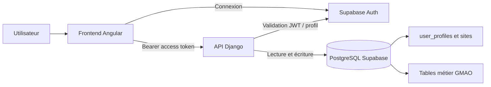

# GMAO ORDC

Plateforme web de gestion de maintenance assistée par ordinateur pour centraliser le suivi des équipements, des interventions, des tickets, des groupes électrogènes, du carburant, du PUE, des problèmes Data Center et des pièces de rechange sur les sites Orange RDC.

> Guide pratique : [déploiement GitHub, Vercel et Render](DEPLOIEMENT.md).

## Sommaire

- [Fonctionnalités](#fonctionnalités)
- [Architecture](#architecture)
- [Technologies](#technologies)
- [Rôles et permissions](#rôles-et-permissions)
- [Structure du dépôt](#structure-du-dépôt)
- [Installation locale](#installation-locale)
- [Configuration](#configuration)
- [Base de données](#base-de-données)
- [API](#api)
- [Règles métier](#règles-métier)
- [Tests et compilation](#tests-et-compilation)
- [Déploiement](#déploiement)
- [Dépannage](#dépannage)
- [Sécurité](#sécurité)

## Fonctionnalités

### Tableau de bord

- Vue consolidée des indicateurs opérationnels.
- Filtrage global par site et par période.
- Synthèse des équipements, tickets, interventions, groupes électrogènes, Fuel-GE et PUE.
- Accès réservé au Manager GMAO et au Chargé des opérations.

### Équipements

- Registre des actifs techniques par site.
- Gestion du nom, de la famille, de la localisation, du modèle, de l’état et de la criticité.
- Génération automatique d’un code de type `EQ-SITE-0001`.
- Suppression possible uniquement pour les rôles globaux.

### Gestion des tickets

- Enregistrement et suivi des demandes ou incidents.
- Association à un site, un équipement, un porteur, une entreprise et un motif.
- Recherche, filtres et pagination.

### Maintenance

- Journal des interventions réalisées.
- Suivi des groupes électrogènes et de leurs compteurs horaires.
- Calcul automatique du nombre d’heures depuis la dernière maintenance préventive.
- Détermination automatique de l’état de maintenance du groupe.

### Fuel-GE

- Suivi mensuel du stock initial, des entrées, de la consommation et du stock final.
- Suivi des heures de fonctionnement des groupes électrogènes.
- Calcul automatique de la consommation en litres par heure.
- Calcul de la disponibilité Grid pour les sites raccordés.

### PUE

- Saisie de l’énergie IT et de l’énergie totale.
- Calcul automatique du PUE : `énergie totale / énergie IT`.
- Suivi par site et par mois.

### Problèmes Data Center

- Journal des constats techniques.
- Suivi du statut, de la priorité, du responsable, de l’échéance, du besoin en pièces et de la prochaine étape.

### Pièces de rechange

- Journal des mouvements de pièces.
- Liaison avec le ticket, l’équipement, l’agent et le statut de l’opération.

### Documentation et exports PDF

- Téléchargement de huit registres complets au format PDF depuis la page **Documentations**.
- Export des données filtrées depuis chaque feuille métier.
- Mise en page automatique en portrait ou paysage selon la largeur du tableau.
- Ajout du titre, de la date d’export et des numéros de page.
- Fonction réservée au Manager GMAO et au Chargé des opérations.

## Architecture



Le frontend gère l’interface, les filtres et la génération des PDF. Supabase Auth fournit les sessions utilisateur. Chaque appel métier envoie le jeton Supabase à Django. Le backend valide ce jeton, charge le profil actif, applique les droits du rôle et accède ensuite à PostgreSQL.

## Technologies

| Couche | Technologies |
|---|---|
| Frontend | Angular 22, TypeScript 6, RxJS, Bootstrap 5, Bootstrap Icons |
| Authentification | Supabase Auth |
| Backend | Python 3.14, Django 6 |
| Base de données | PostgreSQL Supabase, SQLite comme repli local |
| PDF | jsPDF et jsPDF-AutoTable |
| Tests frontend | Vitest |
| Serveur de production | Gunicorn |
| Conteneur et hébergement | Docker, Render |

## Rôles et permissions

Les rôles reconnus sont `manager`, `charge_operations` et `chef_site`.

| Action | Manager GMAO | Chargé des opérations | Chef de site |
|---|:---:|:---:|:---:|
| Voir tous les sites | Oui | Oui | Non |
| Voir son propre site | Oui | Oui | Oui |
| Accéder au tableau de bord global | Oui | Oui | Non |
| Accéder à Documentations | Oui | Oui | Non |
| Créer une fiche | Oui | Oui | Oui, sur son site |
| Modifier une fiche existante | Oui | Oui | Non, sauf suivi GE autorisé |
| Exporter les données en PDF | Oui | Oui | Non |
| Supprimer un équipement | Oui | Oui | Non |
| Supprimer une autre fiche métier | Non | Non | Non |

Le backend reste l’autorité finale : masquer un bouton dans Angular ne remplace jamais le contrôle de permission effectué par Django.

## Structure du dépôt

```text
GMAO-Web/
├── README.md
├── render.yaml
├── gmao-frontend/
│   ├── public/images/              # Logos et arrière-plans
│   ├── src/app/
│   │   ├── auth/                   # Session, gardes et contrôle d’accès
│   │   ├── components/             # Barre latérale
│   │   ├── data/                   # API, store et liste des sites
│   │   ├── pages/                  # Pages métier
│   │   └── shared/                 # Service d’export PDF
│   ├── src/environments/           # URL API et configuration Supabase
│   ├── supabase/                   # Politiques d’accès des profils
│   ├── angular.json
│   └── package.json
└── gmao/
    ├── gmao_backend/               # Configuration et routes Django
    ├── profiles/                   # Authentification, modèles, API et permissions
    ├── sql/                        # Schéma et données PostgreSQL
    ├── scripts/                    # Scripts de contrôle/import
    ├── Dockerfile
    ├── manage.py
    ├── requirements.txt
    └── start-django.ps1
```

## Installation locale

### Prérequis

- Node.js compatible avec Angular 22.
- npm.
- Python 3.14.
- Un projet Supabase avec Auth et PostgreSQL.
- PowerShell sous Windows pour utiliser les scripts fournis.

### 1. Installer le frontend

```powershell
cd C:\Users\JK\Projects\GMAO-Web\gmao-frontend
npm install
npm start
```

Le frontend est disponible sur [http://localhost:4200](http://localhost:4200).

### 2. Installer le backend

```powershell
cd C:\Users\JK\Projects\GMAO-Web\gmao
python -m venv .venv
.\.venv\Scripts\python.exe -m pip install -r requirements.txt
.\start-django.ps1
```

Au premier lancement, le script demande le mot de passe PostgreSQL Supabase, le confirme, puis le conserve sous forme chiffrée dans `gmao/.runtime/`. Ce répertoire est exclu du dépôt.

Le backend est disponible sur [http://localhost:8080](http://localhost:8080).

### 3. Vérifier les services

```powershell
Invoke-WebRequest http://localhost:8080/health
Invoke-WebRequest http://localhost:8080/health/database
```

Réponses attendues :

```json
{"status": "UP"}
```

```json
{"status": "UP", "database": "UP", "responseTimeMs": 12}
```

## Configuration

### Frontend

La configuration locale se trouve dans `gmao-frontend/src/environments/environment.ts` :

```ts
export const environment = {
  production: false,
  apiUrl: 'http://localhost:8080',
  supabaseUrl: 'https://VOTRE-PROJET.supabase.co',
  supabasePublishableKey: 'VOTRE_CLE_PUBLIQUE',
};
```

La clé publique Supabase peut être exposée au navigateur. Elle ne doit toutefois jamais être remplacée par une clé `service_role`.

### Backend

| Variable | Utilité | Valeur locale par défaut |
|---|---|---|
| `DJANGO_SECRET_KEY` | Clé cryptographique Django | Valeur de développement uniquement |
| `DJANGO_DEBUG` | Active le mode debug | `true` |
| `DJANGO_ALLOWED_HOSTS` | Hôtes autorisés, séparés par des virgules | `localhost,127.0.0.1` |
| `FRONTEND_ORIGINS` | Origines CORS autorisées | Ports Angular locaux |
| `SUPABASE_DB_HOST` | Hôte PostgreSQL | Pooler du projet |
| `SUPABASE_DB_PORT` | Port PostgreSQL | `5432` |
| `SUPABASE_DB_NAME` | Nom de la base | `postgres` |
| `SUPABASE_DB_USERNAME` | Utilisateur PostgreSQL | Utilisateur du projet |
| `SUPABASE_DB_PASSWORD` | Mot de passe PostgreSQL | Aucun |
| `DB_CONNECT_TIMEOUT` | Délai de connexion en secondes | `5` |
| `SUPABASE_AUTH_URL` | URL du projet Supabase | Projet configuré |
| `SUPABASE_PUBLISHABLE_KEY` | Clé publique utilisée pour Auth | Projet configuré |
| `SUPABASE_AUTH_ISSUER` | Émetteur attendu du JWT | `<URL>/auth/v1` |
| `SUPABASE_JWKS_URL` | Clés publiques de validation JWT | Endpoint JWKS Supabase |
| `SUPABASE_AUTH_AUDIENCE` | Audience attendue | `authenticated` |

Si `SUPABASE_DB_PASSWORD` est absent, Django utilise `gmao/db.sqlite3`. Les modèles métier étant liés à des tables gérées en dehors de Django, PostgreSQL Supabase reste la configuration normale pour utiliser toute l’application.

## Base de données

Les scripts SQL se trouvent dans `gmao/sql/` et doivent être appliqués dans l’ordre numérique :

1. `001_business_tables.sql` : tables métier, index et activation de RLS.
2. `002_import_ge_tanks.sql` : adaptation et import des équipements GE/réservoirs.
3. `003_ge_tracking.sql` : champs et données de suivi des groupes électrogènes.
4. `004_fuel_ge_2026.sql` : journal Fuel-GE et synthèses mensuelles.
5. `005_pue_2026.sql` : suivi PUE.
6. `006_fuel_site_stocks_2026.sql` : stocks de carburant par site.

Le fichier `gmao-frontend/supabase/role-access-policies.sql` configure les contraintes et politiques d’accès de `user_profiles`.

### Tables principales

- `user_profiles` : profil, rôle, site et état actif de l’utilisateur.
- `sites` : référentiel des sites et codes utilisés pour les équipements.
- `gmao_equipements`
- `gmao_tickets`
- `gmao_groupes_electrogenes`
- `gmao_fuel_ge`
- `gmao_fuel_monthly_summary`
- `gmao_pue`
- `gmao_problemes_datacenter`
- `gmao_interventions`
- `gmao_pieces_rechange`

Les modèles Django utilisent `managed = False` : Django ne crée pas ces tables. Le schéma est administré avec les scripts SQL.

### Création d’un utilisateur

1. Créer le compte dans Supabase Auth.
2. Copier son UUID.
3. Ajouter une ligne correspondante dans `public.user_profiles`.
4. Choisir un rôle valide : `manager`, `charge_operations` ou `chef_site`.
5. Pour un chef de site, renseigner obligatoirement un site existant.
6. Définir `active = true`.

L’UUID du profil doit être identique à l’UUID Supabase Auth.

## API

Toutes les routes métier, sauf les routes de santé, exigent :

```http
Authorization: Bearer <access_token_supabase>
```

### Routes générales

| Méthode | Route | Description |
|---|---|---|
| `GET` | `/health` | Santé du serveur |
| `GET` | `/health/database` | Santé et temps de réponse PostgreSQL |
| `GET` | `/api/me` | Profil connecté et permissions calculées |

### Routes métier

| Méthode | Route | Description |
|---|---|---|
| `GET` | `/api/records/<ressource>` | Liste accessible au profil |
| `POST` | `/api/records/<ressource>` | Création d’une fiche |
| `PUT` ou `PATCH` | `/api/records/<ressource>/<uuid>` | Modification d’une fiche |
| `DELETE` | `/api/records/<ressource>/<uuid>` | Suppression selon les permissions |

Ressources reconnues :

- `equipements`
- `tickets`
- `groupes-electrogenes`
- `fuel-ge`
- `fuel-summary`
- `pue`
- `problemes-datacenter`
- `interventions`
- `pieces-rechange`

Le backend renvoie uniquement les données du site affecté lorsqu’un chef de site est connecté. Les rôles globaux reçoivent les données de tous les sites actifs.

## Règles métier

### Groupes électrogènes

- `RH depuis dernière PM = RH actuel - RH dernière PM`.
- `RH prochaine PM = RH dernière PM + 250`.
- État **Normal** avant 175 heures.
- État **À surveiller** à partir de 175 heures ou en cas de retard signalé.
- État **PM urgente** à partir de 225 heures.
- État **PM dépassée** à partir de 250 heures.

### Fuel-GE

- La période doit respecter le format `AAAA-MM`.
- Les volumes et les heures ne peuvent pas être négatifs.
- `litres/heure = consommation / heures GE`.
- La disponibilité Grid est calculée à partir des heures du mois et des heures GE.
- Kikwit et Mbandaka sont considérés comme des sites sans Grid : disponibilité fixée à 0 et énergie SNEL non applicable.

### PUE

- Les énergies IT et totale doivent être strictement positives.
- L’énergie totale ne peut pas être inférieure à l’énergie IT.
- `PUE = énergie totale / énergie IT`.

### Sites

Les libellés doivent correspondre exactement aux données PostgreSQL, notamment `Mbuji mayi`, `MTC` et `New MTC`, car les filtres utilisent les noms des sites.

## Tests et compilation

### Frontend

```powershell
cd gmao-frontend
npm test -- --watch=false
npm run build
```

Les fichiers compilés sont générés dans `gmao-frontend/dist/gmao-frontend/`.

### Backend

```powershell
cd gmao
.\.venv\Scripts\python.exe manage.py test
```

Avant une livraison, vérifier au minimum :

- la connexion et la déconnexion ;
- les permissions de chacun des trois rôles ;
- les filtres du tableau de bord ;
- la création et la modification des fiches ;
- l’isolation du chef de site ;
- les exports PDF ;
- `/health` et `/health/database`.

## Déploiement

Le fichier `render.yaml` décrit le service backend Render :

- service web Docker nommé `gmao-ordc-api` ;
- plan gratuit ;
- région Frankfurt ;
- contrôle de santé sur `/health` ;
- déploiement automatique à chaque commit ;
- Gunicorn avec deux workers et quatre threads.

Le backend est construit à partir de `gmao/Dockerfile`. Sur Render, renseigner au minimum :

- `SUPABASE_DB_PASSWORD` ;
- `FRONTEND_ORIGINS` avec l’URL HTTPS exacte du frontend ;
- une valeur forte pour `DJANGO_SECRET_KEY` si elle n’est pas générée automatiquement.

Pour le frontend, effectuer un build Angular et publier le contenu généré sur l’hébergeur choisi. Avant le build de production, remplacer `apiUrl` par l’URL HTTPS du backend et vérifier la configuration Supabase.

## Dépannage

### Le frontend ne charge aucune donnée

- Vérifier que Django répond sur `http://localhost:8080/health`.
- Vérifier `environment.apiUrl`.
- Contrôler la session Supabase dans le navigateur.
- Vérifier que le compte possède un profil actif dans `user_profiles`.
- Tester `/health/database`.

### Un site ne retourne aucune donnée

- Comparer le libellé du filtre avec la valeur exacte de la colonne `site`.
- Respecter les espaces et la casse, par exemple `Mbuji mayi`, `MTC` et `New MTC`.
- Vérifier que le site est actif dans la table `sites`.

### Erreur CORS

- Ajouter l’origine exacte du frontend dans `FRONTEND_ORIGINS`.
- Séparer plusieurs origines par des virgules.
- Ne pas ajouter de barre oblique finale si le navigateur n’en envoie pas.

### Le profil est refusé

- Vérifier que l’UUID Auth correspond à l’UUID de `user_profiles`.
- Vérifier `active = true`.
- Utiliser un rôle reconnu.
- Affecter obligatoirement un site au rôle `chef_site`.

### La base distante ne se connecte pas

- Vérifier le mot de passe et les paramètres du pooler Supabase.
- Vérifier que le port 5432 est accessible.
- Relancer `start-django.ps1` si l’identifiant chiffré local doit être recréé.

## Sécurité

- Ne jamais versionner le mot de passe PostgreSQL, une clé `service_role`, un JWT ou un fichier `.env`.
- Conserver uniquement la clé publique Supabase dans le frontend.
- Utiliser HTTPS en production.
- Désactiver `DJANGO_DEBUG` en production.
- Restreindre `DJANGO_ALLOWED_HOSTS` et `FRONTEND_ORIGINS`.
- Maintenir les contrôles d’autorisation côté Django, même si l’interface masque déjà les actions interdites.
- Sauvegarder régulièrement la base PostgreSQL et tester la restauration.

---

Ce README décrit l’état actuel du projet GMAO ORDC et doit être mis à jour lors de l’ajout d’un module, d’un rôle, d’une table, d’une route API ou d’une nouvelle règle métier.
