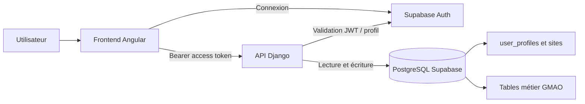

# DC SiteOps Reporting

Plateforme web de reporting et de traçabilité des opérations sur les sites Data Center ORDC. Elle centralise les équipements, interventions, tickets, groupes électrogènes, carburant, PUE, problèmes Data Center, pièces de rechange et ravitaillements Fuel.

> Guide pratique : [déploiement GitHub, Vercel et Render](DEPLOIEMENT.md).

## Accès au projet

| Environnement | Adresse |
|---|---|
| Application de production | [https://gmao-ordc.vercel.app](https://gmao-ordc.vercel.app) |
| API de production | [https://gmao-ordc-api.onrender.com](https://gmao-ordc-api.onrender.com) |
| Santé de l’API | [https://gmao-ordc-api.onrender.com/health](https://gmao-ordc-api.onrender.com/health) |
| Dépôt GitHub | [Projet_Reporting_DC](https://github.com/jeancykabengele-code/Projet_Reporting_DC) |

> Le backend utilise actuellement une instance Render gratuite. Après une période d’inactivité, la première requête peut prendre environ 50 secondes ou davantage pendant le redémarrage du service.

## Sommaire

- [Accès au projet](#accès-au-projet)
- [Fonctionnalités](#fonctionnalités)
- [Architecture](#architecture)
- [Technologies](#technologies)
- [Charte visuelle Orange](#charte-visuelle-orange)
- [Rôles et permissions](#rôles-et-permissions)
- [Structure du dépôt](#structure-du-dépôt)
- [Installation locale](#installation-locale)
- [Configuration](#configuration)
- [Base de données](#base-de-données)
- [API](#api)
- [Règles métier](#règles-métier)
- [Tests et compilation](#tests-et-compilation)
- [Déploiement](#déploiement)
- [Dépannage](#dépannage)
- [Évolutions prévues](#évolutions-prévues)
- [Sécurité](#sécurité)

## Fonctionnalités

### Tableau de bord

- Vue consolidée des indicateurs opérationnels.
- Filtrage global par site et par période.
- Synthèse des équipements, tickets, interventions, groupes électrogènes, Fuel-GE et PUE.
- Accès réservé au Manager GMAO et au Chargé des opérations.

### Équipements

- Registre des actifs techniques par site.
- Gestion du nom, de la famille, de la localisation, du modèle, de l’état et de la criticité.
- Génération automatique d’un code de type `EQ-SITE-0001`.
- Suppression possible uniquement pour les rôles globaux.

### Gestion des tickets

- Enregistrement et suivi des demandes ou incidents.
- Association à un site, un équipement, un porteur, une entreprise et un motif.
- Recherche, filtres et pagination.

### Maintenance

- Journal des interventions réalisées.
- Suivi des groupes électrogènes et de leurs compteurs horaires.
- Calcul automatique du nombre d’heures depuis la dernière maintenance préventive.
- Détermination automatique de l’état de maintenance du groupe.

### Fuel-GE

- Le chef de site renseigne le site, le mois et le kWh SNEL lorsque le site est raccordé ; la consommation Fuel est calculée, elle n’est jamais saisie dans cette feuille.
- Fuel-GE additionne automatiquement les consommations par groupe GE du site pour le mois sélectionné.
- Le stock initial, les ravitaillements du mois, les heures GE, le stock final, les litres par heure et la disponibilité Grid sont calculés par Django.
- Le premier stock de départ est défini une seule fois par le Chef de site, le Manager ou le Chargé des opérations.
- Toute modification d’un ravitaillement, d’un relevé RH GE ou d’un ancien journal recalcule les journaux Fuel-GE dépendants du même site.
- Les champs calculés sont protégés : l’API refuse toute modification manuelle de ces valeurs.
- Le Manager et le Chargé des opérations peuvent supprimer une ligne Fuel-GE depuis le formulaire de modification. Les mois suivants sont recalculés ; la suppression est refusée si elle rend un stock de départ incohérent.

### Liaisons entre les feuilles Fuel et GE

Les données sont reliées par le **site**, le **mois (`AAAA-MM`)** et, pour les relevés/consommations, le **code du groupe**. L’équipement enregistré dans **Équipements** est la source du code, du nom et du site des groupes électrogènes proposés dans **Suivi groupes électrogènes**.

1. **Suivi groupes électrogènes** enregistre un relevé RH par groupe et par mois. Les heures d’un groupe sont calculées par `RH du mois − RH du relevé précédent`. Une référence de décembre permet donc de calculer les heures de janvier.
2. **Consommation par groupe GE** reçoit les litres saisis pour le même groupe et le même mois. Elle reprend les heures calculées au point 1 et calcule `L/h = litres / heures`.
3. **Ravitaillement Fuel** enregistre chaque livraison datée. Sa quantité est additionnée automatiquement dans le mois concerné ; les stocks avant/après servent de contrôle physique de la livraison et ne remplacent pas les calculs Fuel-GE.
4. **Fuel-GE** est la synthèse mensuelle du site : `stock final = stock initial + somme des ravitaillements − somme des consommations`. Il additionne également les heures de tous les groupes et calcule la moyenne `L/h`. Dès le deuxième mois, le stock initial reprend le stock final du mois précédent.

Une création, une modification ou une suppression de relevé RH, consommation ou ravitaillement recalcule Fuel-GE du mois concerné et les mois suivants du site. Les modifications et suppressions effectuées par le Manager ou le Chargé des opérations passent par l’API Django : l’enregistrement est d’abord mis à jour ou supprimé dans PostgreSQL, puis l’interface est rafraîchie.
### Consommation par groupe GE

- Suivi mensuel de la consommation Fuel de chaque groupe électrogène.
- Une seule ligne est autorisée par combinaison **site + mois + groupe**.
- Le chef de site saisit les litres consommés et un commentaire facultatif.
- Les heures GE sont calculées depuis les deux derniers relevés RH du groupe : `RH du mois − RH précédent`.
- Une saisie est refusée si un relevé RH manque, si le compteur diminue, ou si les litres sont négatifs.
- Les L/h sont calculés automatiquement. La somme des groupes alimente Fuel-GE ; toute création, correction ou suppression recalcule le mois concerné et les mois suivants.
- La table Supabase est définie dans `gmao/sql/009_generator_fuel_consumption.sql`.
### Ravitaillement Fuel

- Enregistrement des livraisons entrantes de carburant par site.
- Les imports historiques peuvent conserver les stocks avant/après à « Non renseigné » lorsqu’ils ne sont pas disponibles.
- Calcul automatique du stock après livraison et signalement des écarts.
- Le chef de site ajoute les ravitaillements de son site ; les rôles globaux consultent les données de tous les sites.
- Chaque nouvel enregistrement notifie le Manager GMAO et le Chargé des opérations.
- Le schéma PostgreSQL correspondant se trouve dans `gmao/sql/008_fuel_deliveries.sql`.

### PUE

- Saisie de l’énergie IT et de l’énergie totale.
- Calcul automatique du PUE : `énergie totale / énergie IT`.
- Suivi par site et par mois.

### Problèmes Data Center

- Journal des constats techniques.
- Suivi du statut, de la priorité, du responsable, de l’échéance, du besoin en pièces et de la prochaine étape.

### Pièces de rechange

- Journal des mouvements de pièces.
- Liaison avec le ticket, l’équipement, l’agent et le statut de l’opération.


### Gestion des utilisateurs depuis le back office

- Les rôles globaux peuvent ouvrir **Administration → Gestion des utilisateurs**.
- Le formulaire permet de saisir le nom complet, l’adresse e-mail, le rôle et le site du chef de site.
- Django appelle Supabase Auth avec `SUPABASE_SERVICE_ROLE_KEY`, puis crée automatiquement le profil dans `user_profiles`.
- Une invitation de connexion est envoyée par Supabase Auth.
- La clé `service_role` doit être configurée uniquement comme variable secrète Render ; elle ne doit jamais être exposée dans Angular.
- La désactivation conserve le compte et son historique ; elle est recommandée dès qu’un profil possède des données métier.

### Modification des profils

- Le manager et le chef des opérations peuvent modifier le nom complet, le rôle, le site associé et le statut actif/inactif.
- L’adresse e-mail reste non modifiable depuis cette feuille afin de préserver l’identifiant Supabase Auth.
- Un chef de site doit toujours être associé à un site actif.
- Un administrateur ne peut pas désactiver son propre compte depuis cette interface.
- La désactivation conserve le profil, les fiches métier et l historique ; le backend refuse ensuite le chargement du profil à la connexion.

### Suppression sécurisée des profils

- Le bouton **Supprimer définitivement** ouvre une confirmation intégrée à l’application, sans boîte de dialogue du navigateur.
- La suppression est refusée pour son propre compte, pour un profil encore affecté à un site, ou dès qu’une donnée métier a été créée ou modifiée par ce profil.
- Dans ces cas, il faut désactiver le compte afin de conserver l’historique et empêcher toute nouvelle connexion.
- Si aucun historique ni affectation active n’existe, Django supprime le compte dans Supabase Auth puis la ligne correspondante dans `user_profiles`.
- La clé `SUPABASE_SERVICE_ROLE_KEY` est nécessaire côté Render uniquement ; elle ne doit jamais être exposée au frontend ni versionnée dans Git.

### Documentation et exports Excel XLSX

- Téléchargement de neuf registres complets au format Excel XLSX depuis la page **Documentations**.
- Export des données filtrées depuis chaque feuille métier.
- Classeur XLSX structuré avec une feuille nommée, des cellules typées et des colonnes ajustées.
- Ajout du titre, de la date d’export, d’un en-tête figé et d’une mise en forme lisible.
- Fonction réservée au Manager GMAO et au Chargé des opérations.

### Formulaires de renseignement

- L’enregistrement est transmis à l’API Django.
- Après une réponse réussie, la feuille de saisie se ferme automatiquement et la liste locale est actualisée.
- Si l’enregistrement échoue, la feuille reste ouverte afin de préserver les informations saisies.
- Cette fermeture fiable est appliquée aux équipements, tickets, groupes électrogènes, Fuel-GE, PUE, problèmes Data Center, interventions et pièces de rechange.

### Navigation depuis une notification

- Un clic marque immédiatement la notification comme lue et la retire de la barre latérale.
- La feuille métier concernée est ouverte avec l’identifiant de la fiche.
- Les filtres incompatibles sont réinitialisés.
- La pagination sélectionne automatiquement la page contenant l’enregistrement.
- Le tableau défile jusqu’à la ligne concernée et la met temporairement en évidence.

### Limite actuelle des imports

La fonctionnalité utilisateur actuelle couvre les exports Excel XLSX. Aucun import massif PDF ou CSV n’est exposé dans l’interface. L’import massif XLSX avec validation reste une évolution prévue.

## Architecture



Le frontend gère l’interface, les filtres et la génération des fichiers Excel XLSX. Supabase Auth fournit les sessions utilisateur. Chaque appel métier envoie le jeton Supabase à Django. Le backend valide ce jeton, charge le profil actif, applique les droits du rôle et accède ensuite à PostgreSQL.

## Technologies

| Couche | Technologies |
|---|---|
| Frontend | Angular 22, TypeScript 6, RxJS, Bootstrap 5, icônes Solaris |
| Authentification | Supabase Auth |
| Backend | Python 3.14, Django 6 |
| Base de données | PostgreSQL Supabase, SQLite comme repli local |
| Excel XLSX | write-excel-file |
| Tests frontend | Vitest |
| Serveur de production | Gunicorn |
| Conteneur et hébergement | Docker, Render |

## Charte visuelle Orange

L’interface applique la charte Orange sur l’ensemble des écrans.

- **Typographie** : Helvetica Neue 55 (texte courant), 65 (intermédiaire) et 75 (titres et éléments forts).
- **Logo** : Master Logo Orange officiel, conservé dans son format carré avec une zone de sécurité et un affichage responsive desktop/mobile.
- **Couleurs principales** : noir, blanc, Orange `#FF7900` et gris numérique.
- **Icônes** : pack Solaris local. `bootstrap-icons` n’est plus chargé ni déclaré comme dépendance.
- **Composants** : menu, boutons, tableaux, formulaires, alertes, fenêtres et focus utilisent le système de couleurs Orange.
- **États métier** : vert réservé à la validation, Orange à l’attention ou au suivi, rouge aux erreurs et situations critiques ; gris pour les informations neutres.
- **Graphiques** : Orange est la série principale ; les gris servent aux comparaisons et les couleurs d’état uniquement aux données métier concernées.

Les ressources de la charte se trouvent dans `gmao-frontend/public/assets/orange/` :

```text
gmao-frontend/public/assets/orange/
├── fonts/                         # Helvetica Neue 55, 65 et 75
├── icons/                         # Icônes Solaris officielles
│   └── manifest.json              # Correspondance historique Bootstrap → Solaris
└── logo/orange-master-logo.png    # Master Logo officiel
```
## Rôles et permissions

Les rôles reconnus sont `manager`, `charge_operations` et `chef_site`.

| Action | Manager GMAO | Chargé des opérations | Chef de site |
|---|:---:|:---:|:---:|
| Voir tous les sites | Oui | Oui | Non |
| Voir son propre site | Oui | Oui | Oui |
| Accéder au tableau de bord global | Oui | Oui | Non |
| Accéder à Documentations | Oui | Oui | Non |
| Créer une fiche | Oui | Oui | Oui, sur son site |
| Modifier une fiche existante | Oui, toutes les fiches | Oui, toutes les fiches | Selon les droits de son site |
| Exporter les données en Excel XLSX | Oui | Oui | Non |
| Supprimer un équipement | Oui | Oui | Non |
| Supprimer une autre fiche métier | Oui, toutes les fiches | Oui, toutes les fiches | Non |

Le backend reste l’autorité finale : masquer un bouton dans Angular ne remplace jamais le contrôle de permission effectué par Django.

## Structure du dépôt

```text
GMAO-Web/
├── README.md
├── render.yaml
├── gmao-frontend/
│   ├── public/assets/orange/       # Polices Helvetica, Master Logo et icônes Solaris
│   ├── public/images/              # Arrière-plans
│   ├── src/app/
│   │   ├── auth/                   # Session, gardes et contrôle d’accès
│   │   ├── components/             # Barre latérale
│   │   ├── data/                   # API, store et liste des sites
│   │   ├── pages/                  # Pages métier
│   │   └── shared/                 # Service d’export Excel XLSX
│   ├── src/environments/           # URL API et configuration Supabase
│   ├── supabase/                   # Politiques d’accès des profils
│   ├── angular.json
│   └── package.json
└── gmao/
    ├── gmao_backend/               # Configuration et routes Django
    ├── profiles/                   # Authentification, modèles, API et permissions
    ├── sql/                        # Schéma et données PostgreSQL
    ├── scripts/                    # Scripts de contrôle/import
    ├── Dockerfile
    ├── manage.py
    ├── requirements.txt
    └── start-django.ps1
```

## Installation locale

### Prérequis

- Node.js compatible avec Angular 22.
- npm.
- Python 3.14.
- Un projet Supabase avec Auth et PostgreSQL.
- PowerShell sous Windows pour utiliser les scripts fournis.

### 1. Installer le frontend

```powershell
cd C:\Users\JK\Projects\GMAO-Web\gmao-frontend
npm install
npm start
```

Le frontend est disponible sur [http://localhost:4200](http://localhost:4200).

### 2. Installer le backend

```powershell
cd C:\Users\JK\Projects\GMAO-Web\gmao
python -m venv .venv
.\.venv\Scripts\python.exe -m pip install -r requirements.txt
.\start-django.ps1
```

Au premier lancement, le script demande le mot de passe PostgreSQL Supabase, le confirme, puis le conserve sous forme chiffrée dans `gmao/.runtime/`. Ce répertoire est exclu du dépôt.

Le backend est disponible sur [http://localhost:8080](http://localhost:8080).

### 3. Vérifier les services

```powershell
Invoke-WebRequest http://localhost:8080/health
Invoke-WebRequest http://localhost:8080/health/database
```

Réponses attendues :

```json
{"status": "UP"}
```

```json
{"status": "UP", "database": "UP", "responseTimeMs": 12}
```

## Configuration

### Frontend

La configuration locale se trouve dans `gmao-frontend/src/environments/environment.ts` :

```ts
export const environment = {
  production: false,
  apiUrl: 'http://localhost:8080',
  supabaseUrl: 'https://VOTRE-PROJET.supabase.co',
  supabasePublishableKey: 'VOTRE_CLE_PUBLIQUE',
};
```

La clé publique Supabase peut être exposée au navigateur. Elle ne doit toutefois jamais être remplacée par une clé `service_role`.

### Backend

| Variable | Utilité | Valeur locale par défaut |
|---|---|---|
| `DJANGO_SECRET_KEY` | Clé cryptographique Django | Valeur de développement uniquement |
| `DJANGO_DEBUG` | Active le mode debug | `true` |
| `DJANGO_ALLOWED_HOSTS` | Hôtes autorisés, séparés par des virgules | `localhost,127.0.0.1` |
| `FRONTEND_ORIGINS` | Origines CORS autorisées | Ports Angular locaux |
| `SUPABASE_DB_HOST` | Hôte PostgreSQL | Pooler du projet |
| `SUPABASE_DB_PORT` | Port PostgreSQL | `5432` |
| `SUPABASE_DB_NAME` | Nom de la base | `postgres` |
| `SUPABASE_DB_USERNAME` | Utilisateur PostgreSQL | Utilisateur du projet |
| `SUPABASE_DB_PASSWORD` | Mot de passe PostgreSQL | Aucun |
| `DB_CONNECT_TIMEOUT` | Délai de connexion en secondes | `5` |
| `SUPABASE_AUTH_URL` | URL du projet Supabase | Projet configuré |
| `SUPABASE_PUBLISHABLE_KEY` | Clé publique utilisée pour Auth | Projet configuré |
| `SUPABASE_AUTH_ISSUER` | Émetteur attendu du JWT | `<URL>/auth/v1` |
| `SUPABASE_JWKS_URL` | Clés publiques de validation JWT | Endpoint JWKS Supabase |
| `SUPABASE_AUTH_AUDIENCE` | Audience attendue | `authenticated` |
| `SUPABASE_SERVICE_ROLE_KEY` | Clé serveur pour invitations Auth | Obligatoire sur Render, jamais dans le frontend |

Si `SUPABASE_DB_PASSWORD` est absent, Django utilise `gmao/db.sqlite3`. Les modèles métier étant liés à des tables gérées en dehors de Django, PostgreSQL Supabase reste la configuration normale pour utiliser toute l’application.

## Base de données

Les scripts SQL se trouvent dans `gmao/sql/` et doivent être appliqués dans l’ordre numérique :

1. `001_business_tables.sql` : tables métier, index et activation de RLS.
2. `002_import_ge_tanks.sql` : adaptation et import des équipements GE/réservoirs.
3. `003_ge_tracking.sql` : champs et données de suivi des groupes électrogènes.
4. `004_fuel_ge_2026.sql` : journal Fuel-GE et synthèses mensuelles.
5. `005_pue_2026.sql` : suivi PUE.
6. `006_fuel_site_stocks_2026.sql` : stocks de carburant par site.
7. `007_notifications.sql` : notifications persistantes, index, RLS et publication Realtime.
8. `008_fuel_deliveries.sql` : ravitaillements Fuel, calcul du stock et écarts.

Le fichier `gmao-frontend/supabase/role-access-policies.sql` configure les contraintes et politiques d’accès de `user_profiles`.

### Tables principales

- `user_profiles` : profil, rôle, site et état actif de l’utilisateur.
- `sites` : référentiel des sites et codes utilisés pour les équipements.
- `gmao_equipements`
- `gmao_tickets`
- `gmao_groupes_electrogenes`
- `gmao_fuel_ge`
- `gmao_fuel_monthly_summary`
- `gmao_pue`
- `gmao_problemes_datacenter`
- `gmao_interventions`
- `gmao_pieces_rechange`
- `gmao_notifications` : alertes et notifications personnelles du Manager et du Chef des opérations.

Les modèles Django utilisent `managed = False` : Django ne crée pas ces tables. Le schéma est administré avec les scripts SQL.

### Création d’un utilisateur

1. Créer le compte dans Supabase Auth.
2. Copier son UUID.
3. Ajouter une ligne correspondante dans `public.user_profiles`.
4. Choisir un rôle valide : `manager`, `charge_operations` ou `chef_site`.
5. Pour un chef de site, renseigner obligatoirement un site existant.
6. Définir `active = true`.

L’UUID du profil doit être identique à l’UUID Supabase Auth.

## API

Toutes les routes métier, sauf les routes de santé, exigent :

```http
Authorization: Bearer <access_token_supabase>
```

### Routes générales

| Méthode | Route | Description |
|---|---|---|
| `GET` | `/health` | Santé du serveur |
| `GET` | `/health/database` | Santé et temps de réponse PostgreSQL |
| `GET` | `/api/me` | Profil connecté et permissions calculées |
| `GET` | `/api/notifications` | Notifications personnelles du rôle global connecté |
| `PATCH` | `/api/notifications/<uuid>/read` | Marquer une notification comme lue |
| `PATCH` | `/api/notifications/read-all` | Marquer toutes les notifications comme lues |

### Routes métier

| Méthode | Route | Description |
|---|---|---|
| `GET` | `/api/records/<ressource>` | Liste accessible au profil |
| `POST` | `/api/records/<ressource>` | Création d’une fiche |
| `PUT` ou `PATCH` | `/api/records/<ressource>/<uuid>` | Modification d’une fiche |
| `DELETE` | `/api/records/<ressource>/<uuid>` | Suppression selon les permissions |

Ressources reconnues :

- `equipements`
- `tickets`
- `groupes-electrogenes`
- `fuel-ge`
- `fuel-summary`
- `pue`
- `problemes-datacenter`
- `interventions`
- `pieces-rechange`

Le backend renvoie uniquement les données du site affecté lorsqu’un chef de site est connecté. Les rôles globaux reçoivent les données de tous les sites actifs.

## Règles métier

### Groupes électrogènes

- `RH depuis dernière PM = RH actuel - RH dernière PM`.
- `RH prochaine PM = RH dernière PM + 250`.
- État **Normal** avant 175 heures.
- État **À surveiller** à partir de 175 heures ou en cas de retard signalé.
- État **PM urgente** à partir de 225 heures.
- État **PM dépassée** à partir de 250 heures.

### Saisie quotidienne des compteurs GE

- Le champ **RH actuel** est le compteur cumulatif lu sur l’armoire du groupe.
- Si le groupe n’a pas fonctionné, on conserve la dernière valeur (on ne saisit pas zéro).
- Si le groupe a fonctionné 20 heures et affichait 200 h, on saisit 220 h, jamais seulement 20 h.
- **RH depuis dernière PM** et **RH prochaine PM** restent calculés automatiquement par l’API ; aucune saisie manuelle de ces résultats n’est nécessaire.
- Chaque enregistrement met à jour automatiquement le champ updated_at, affiché dans la feuille comme dernier relevé.
- La feuille indique la fraîcheur du relevé : **À jour** (< 7 jours), **À mettre à jour** (7 à 13 jours) ou **Relevé ancien** (14 jours ou plus).
- Cette indication signale qu’une nouvelle lecture terrain est nécessaire ; elle ne modifie pas le classement PM ni le compteur cumulatif.
### Notifications internes

- Chaque fiche ajoutée par un Chef de site produit une notification persistante pour le Manager et le Chargé des opérations.
- Une préalerte GE de niveau warning est créée à partir de 150 heures depuis la dernière PM.
- Les passages à **À surveiller** (175 h), **PM urgente** (225 h) et **PM dépassée** (250 h) créent une alerte warning ou critical.
- Une même étape n’est notifiée qu’une fois par groupe, destinataire et cycle de maintenance.
- Le badge **Notifications** affiche le nombre total d’éléments non lus.
- Le frontend charge les notifications à la connexion, à l’ouverture du panneau, puis toutes les 30 secondes.
- Un clic marque la notification comme lue, la retire du panneau et ouvre exactement la ligne du tableau concerné.
- L’action **Tout lire** vide la liste des notifications non lues.
- Les Chefs de site ne voient pas le centre de notifications global.
- Les notifications sont persistées dans la table gmao_notifications et restent cohérentes après une reconnexion.
- Les relevés GE non actualisés depuis 7 jours génèrent une notification warning « Relevé GE à mettre à jour » ; à partir de 14 jours, une notification critical « Relevé GE ancien » est créée pour les Managers et Chargés des opérations. La vérification est effectuée automatiquement lors du rafraîchissement du centre de notifications.

### Fuel-GE

- La période doit respecter le format `AAAA-MM`.
- Les volumes et les heures ne peuvent pas être négatifs.
- Pour le premier mois d’un site, le Chef de site, le Manager ou le Chargé des opérations définit une fois le stock de départ. Pour les mois suivants, `stock initial = stock final du dernier journal antérieur`.
- `ravitaillements du mois = somme des livraisons Fuel du site pendant la période`.
- `heures GE = somme, par groupe, de RH actuel − RH du relevé précédent`.
- `stock final = stock initial + ravitaillements − consommation` ; une consommation entraînant un stock négatif est refusée.
- `litres/heure = consommation / heures GE` lorsque les heures GE sont supérieures à zéro.
- La disponibilité Grid est calculée à partir des heures du mois et des heures GE.
- Modifier un ravitaillement, un relevé RH ou un journal Fuel-GE recalcule automatiquement le mois concerné et les mois suivants du même site, dans une transaction.
- Les champs de calcul (ravitaillements, stocks finaux, heures GE, L/h et disponibilité Grid) ne sont jamais acceptés comme saisie manuelle par l’API.
- Kikwit et Mbandaka sont considérés comme des sites sans Grid : disponibilité fixée à 0 et énergie SNEL non applicable.

### Consommation par groupe GE

- Suivi mensuel de la consommation Fuel de chaque groupe électrogène.
- Une seule ligne est autorisée par combinaison **site + mois + groupe**.
- Le chef de site saisit les litres consommés et un commentaire facultatif.
- Les heures GE sont calculées depuis les deux derniers relevés RH du groupe : `RH du mois − RH précédent`.
- Une saisie est refusée si un relevé RH manque, si le compteur diminue, ou si les litres sont négatifs.
- Les L/h sont calculés automatiquement. La somme des groupes alimente Fuel-GE ; toute création, correction ou suppression recalcule le mois concerné et les mois suivants.
- La table Supabase est définie dans `gmao/sql/009_generator_fuel_consumption.sql`.
### Ravitaillement Fuel

- Enregistrement des livraisons entrantes de carburant par site.
- Les imports historiques peuvent conserver les stocks avant/après à « Non renseigné » lorsqu’ils ne sont pas disponibles.
- Calcul automatique du stock après livraison et signalement des écarts.
- Le chef de site ajoute les ravitaillements de son site ; les rôles globaux consultent les données de tous les sites.
- Chaque nouvel enregistrement notifie le Manager GMAO et le Chargé des opérations.
- Le schéma PostgreSQL correspondant se trouve dans `gmao/sql/008_fuel_deliveries.sql`.

### PUE

- Les énergies IT et totale doivent être strictement positives.
- L’énergie totale ne peut pas être inférieure à l’énergie IT.
- `PUE = énergie totale / énergie IT`.

### Sites

Les libellés doivent correspondre exactement aux données PostgreSQL, notamment `Mbuji mayi`, `MTC` et `New MTC`, car les filtres utilisent les noms des sites.

## Tests et compilation

### Frontend

```powershell
cd gmao-frontend
npm test -- --watch=false
npm run build
```

Les fichiers compilés sont générés dans `gmao-frontend/dist/gmao-frontend/`.

État vérifié au 22 septembre 2026 :

- 14 fichiers de tests frontend réussis ;
- 48 tests frontend réussis dans 14 fichiers ;
- compilation Angular de production réussie sans avertissement de budget ;
- seuils de budget calibrés à 1,2 Mo pour le bundle initial et 10 Ko par feuille de style.

### Backend

```powershell
cd gmao
.\.venv\Scripts\python.exe manage.py test
```

Avant une livraison, vérifier au minimum :

- la connexion et la déconnexion ;
- les permissions de chacun des trois rôles ;
- les filtres du tableau de bord ;
- la création et la modification des fiches ;
- l’isolation du chef de site ;
- les exports Excel XLSX ;
- `/health` et `/health/database`.

## Déploiement

Appliquer impérativement `gmao/sql/007_notifications.sql` puis `gmao/sql/008_fuel_deliveries.sql` dans Supabase avant de déployer les versions qui activent les notifications et le ravitaillement Fuel. Les modèles Django sont non gérés : un déploiement Render ne crée pas cette table automatiquement.

Le fichier `render.yaml` décrit le service backend Render :

- service web Docker nommé `gmao-ordc-api` ;
- plan gratuit ;
- région Frankfurt ;
- contrôle de santé sur `/health` ;
- déploiement automatique à chaque commit ;
- Gunicorn avec deux workers et quatre threads.

Le backend est construit à partir de `gmao/Dockerfile`. Sur Render, renseigner au minimum :

- `SUPABASE_DB_PASSWORD` ;
- `FRONTEND_ORIGINS` avec l’URL HTTPS exacte du frontend ;
- une valeur forte pour `DJANGO_SECRET_KEY` si elle n’est pas générée automatiquement.

Pour le frontend, effectuer un build Angular et publier le contenu généré sur l’hébergeur choisi. Avant le build de production, remplacer `apiUrl` par l’URL HTTPS du backend et vérifier la configuration Supabase.

### Environnements de production actuels

- Frontend Vercel : https://gmao-ordc.vercel.app
- Backend Render : https://gmao-ordc-api.onrender.com
- Branche de déploiement : main
- Render et Vercel suivent le dépôt GitHub et redéploient les commits publiés.

Dans Vercel, la racine du projet est gmao-frontend, la commande de build est npm run vercel-build et le dossier publié est dist/gmao-frontend/browser. Le fichier gmao-frontend/vercel.json réécrit les routes Angular vers index.html.

Le build Vercel exige GMAO_API_URL, SUPABASE_URL et SUPABASE_PUBLISHABLE_KEY. La valeur de l’API de production est https://gmao-ordc-api.onrender.com.

## Dépannage

### L’enregistrement réussit mais la feuille reste visible

- Vérifier dans Supabase ou via l’API si la fiche a bien été créée.
- Vérifier la console du navigateur et la réponse de la requête.
- Le frontend Angular fonctionne sans Zone.js : les composants notifient explicitement le changement de vue après les opérations asynchrones.
- Dans la version actuelle, le formulaire se ferme uniquement après une réponse réussie et reste ouvert en cas d’erreur.

### Le premier enregistrement est très lent

- Ouvrir d’abord /health.
- Une instance Render gratuite peut être en veille et nécessiter un redémarrage à froid.
- Tester ensuite /health/database pour distinguer le réveil Render d’un problème PostgreSQL.
- Éviter de cliquer plusieurs fois sur **Enregistrer** pendant le réveil.

### Le frontend ne charge aucune donnée

- Vérifier que Django répond sur `http://localhost:8080/health`.
- Vérifier `environment.apiUrl`.
- Contrôler la session Supabase dans le navigateur.
- Vérifier que le compte possède un profil actif dans `user_profiles`.
- Tester `/health/database`.

### Un site ne retourne aucune donnée

- Comparer le libellé du filtre avec la valeur exacte de la colonne `site`.
- Respecter les espaces et la casse, par exemple `Mbuji mayi`, `MTC` et `New MTC`.
- Vérifier que le site est actif dans la table `sites`.

### Erreur CORS

- Ajouter l’origine exacte du frontend dans `FRONTEND_ORIGINS`.
- Séparer plusieurs origines par des virgules.
- Ne pas ajouter de barre oblique finale si le navigateur n’en envoie pas.

### Le profil est refusé

- Vérifier que l’UUID Auth correspond à l’UUID de `user_profiles`.
- Vérifier `active = true`.
- Utiliser un rôle reconnu.
- Affecter obligatoirement un site au rôle `chef_site`.

### La base distante ne se connecte pas

- Vérifier le mot de passe et les paramètres du pooler Supabase.
- Vérifier que le port 5432 est accessible.
- Relancer `start-django.ps1` si l’identifiant chiffré local doit être recréé.

## Évolutions prévues

- Envoi d’e-mails pour les alertes warning et critical.
- Import massif de données au format Excel XLSX avec validation et rapport d’erreurs.
- Réduction future de la taille du bundle initial et des styles partagés.
- Supervision plus détaillée de la latence API et des échecs d’enregistrement.
- Historique d’audit métier plus complet.

## Audit de préparation — 12 septembre 2026

La réévaluation globale du projet a porté sur le code, les droits, la base de données, les dépendances, la compilation et les services de production.

| Contrôle | Résultat |
|---|---|
| Frontend Angular — build production | Réussi sans avertissement de budget |
| Tests frontend | 48 tests réussis dans 14 fichiers |
| Tests backend Django | 21 tests réussis, vérification Django sans problème |
| API Render /health | HTTP 200, statut UP |
| Base Supabase via /health/database | HTTP 200, base UP |
| Frontend Vercel | HTTP 200 |
| npm audit production | Aucune vulnérabilité détectée |
| pip-audit | Aucune vulnérabilité connue détectée |

### Points à surveiller

- Le plan Render gratuit peut provoquer un délai de réveil après inactivité.
- Les budgets Angular/SCSS sont dépassés sans bloquer le build ; une réduction des bundles reste recommandée.
Les suppressions de sites et équipements utilisent une confirmation intégrée à l application, sans boîte de dialogue du navigateur.
- Le mode SQLite sert au développement local ; la production doit utiliser PostgreSQL Supabase et les scripts SQL jusqu’à 008_fuel_deliveries.sql.
- L’import massif XLSX et les e-mails d’alerte ne sont pas encore activés ; les notifications internes persistantes sont opérationnelles.

## Sécurité

- Ne jamais versionner le mot de passe PostgreSQL, une clé `service_role`, un JWT ou un fichier `.env`.
- Conserver uniquement la clé publique Supabase dans le frontend.
- Utiliser HTTPS en production.
- Désactiver `DJANGO_DEBUG` en production.
- Restreindre `DJANGO_ALLOWED_HOSTS` et `FRONTEND_ORIGINS`.
- Maintenir les contrôles d’autorisation côté Django, même si l’interface masque déjà les actions interdites.
- Sauvegarder régulièrement la base PostgreSQL et tester la restauration.

---

Ce README décrit l’état vérifié du projet GMAO ORDC au **22 septembre 2026**. Il doit être mis à jour lors de l’ajout d’un module, d’un rôle, d’une table, d’une route API, d’une variable d’environnement ou d’une règle métier.

## Administration

La page unique **Administration** regroupe deux onglets : **Gestion des sites** et **Affectation des chefs de site**. Elle est réservée au Manager GMAO et au Chargé des opérations.

- ajouter un site avec un nom et un code unique ;
- modifier le code d’un site ;
- désactiver ou réactiver un site ;
- voir le statut de chaque site.

Les sites actifs sont utilisés automatiquement par les filtres, les formulaires et le tableau de bord. Après l’ajout d’un site, actualiser la session pour recharger la liste des sites autorisés. La désactivation n’efface aucune donnée historique. Un chef de site affecté à un site désactivé ne peut plus se connecter ; son accès revient automatiquement lorsque le site est réactivé.

Routes API protégées : `GET /api/sites`, `POST /api/sites` et `PATCH /api/sites/<nom>`. Seuls les rôles globaux peuvent les utiliser.

La page **Affectation des chefs de site** permet aussi au Manager et au Chargé des opérations de choisir le site actif de chaque compte `chef_site`. Les rôles globaux ne sont pas modifiés par cette page.

